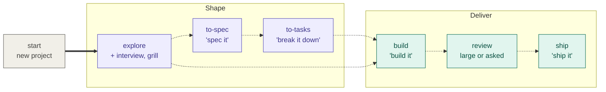

# Flow Skills

**From intent to verified software.** Portable [agent skills](https://agentskills.io) for [Flow](PRODUCT.md), a lightweight, human-led product engineering methodology. You talk to your agent, typed or dictated: "interview me", "spec it", "ship it". Each phrase reaches one skill. Nothing runs unless you ask, and you can use one skill, all of them, or none.

[Flow identity and catalog scope](PRODUCT.md) · **[Skill catalog](docs/skills.md)** · [Methodology](docs/methodology.md) · [Documentation guide](docs/README.md)

## Install

```bash
npx skills add gaboesquivel/flow-skills
```

Choose your agent and install scope in the installer. [Agent compatibility](docs/agent-compatibility.md) covers other install paths and metadata limits. Flow needs no changes to your instruction files; setting up Flow mode adds one removable block, and only when you ask.

## Flow is Git-based

Flow keeps its work in Git: specs, decision records, and the product brief are files committed on branches, and delivery is branches and merges. What you need depends on what you use ([requirements](PRODUCT.md#install-and-catalog), [decision 0037](docs/decisions/0037-git-for-delivery-github-for-github-mode.md)):

| You use | You need |
| --- | --- |
| Thinking skills: `grill`, `interview`, `council`, `align`, `debug`, `tldr`, the writing skills, and the rest | Nothing. Any folder works, with or without Git. |
| The delivery chain: `flow`'s setup, `start`, `explore`, `to-spec`, `to-tasks`, `build`, `review`, `ship`, `board` | A Git repository. Outside one, the skill offers `git init` and stops if you say no. |
| GitHub mode | GitHub access as well: pull requests and preview deployments live there. |

The rules Flow follows in a project live in Git too. "Set up Flow here" writes one [Flow block](GLOSSARY.md#flow-block) into the instruction file Git tracks: `AGENTS.md`, or `CLAUDE.md` with an `@AGENTS.md` import when `AGENTS.md` is ignored. The block holds the phrase table and, when you set one, a `Delivery:` override, and every agent and teammate who clones the repository reads the same rules. Delete the block to opt out.

## Local or GitHub delivery

Local and GitHub are delivery options, not separate methodologies: the skills, phrases, and steps are the same, and only where the work lands differs. Flow never asks which one. It uses GitHub when `origin` is a GitHub repository and `gh` is signed in, and local otherwise; a default branch that requires pull requests always gets GitHub ([decision 0044](docs/decisions/0044-fast-delivery.md)).

| | Local | GitHub |
| --- | --- | --- |
| Needs | Git only. Works with GitLab, Bitbucket, or no remote at all. | Git plus a GitHub repository and an authenticated `gh`. |
| Spec | A file on its feature branch. | The same file; the pull request links it. |
| Tasks | A checklist in the spec's Tasks section. | The same checklist. |
| "Build it" | Ends with the work committed on its branch. | Ends with an open pull request whose body links the spec file. Never waits on CI. |
| "Ship it" | Runs the suite once on the merge result, merges into `main`, and pushes when a remote exists. | Waits for CI once and merges the pull request. |
| Verification | The remote `main` contains the shipped commit; for an app, the production deployment of that commit answers. | The same, on the merge commit. |

In both modes `ship` adds the independent review only when the size guard escalates or you say "review it". To override the inferred mode, add a `Delivery:` line to the Flow block, or say so for one run: "ship it local" or "ship it with GitHub". The full rule lives in [`build`](skills/build/SKILL.md#delivery-mode); the glossary defines [delivery mode](GLOSSARY.md#delivery-mode).

## Work without a spec

Specs are for bets worth tracking, not a toll on every change. In either mode, nothing writes a spec or tasks unless you say "spec it" or "break it down" ([decision 0039](docs/decisions/0039-build-never-requires-a-spec.md)).

- **Say "build it".** With no spec behind it, `build` treats the change as [unspecced work](GLOSSARY.md#unspecced-work) and ends with a ready branch: a committed branch, or an open pull request. "Ship it" checks it once and lands it; its [size guard](skills/build/SKILL.md#unspecced-work) adds the independent review only for a larger or riskier change.
- **Explore, then build.** After "explore this", "build it" builds the confirmed brief directly. The `explore/<slug>` branch becomes the work branch and the brief lands with the code. For a new product, `explore` stops at the brief; spec 001 comes only when you ask. `explore` skips fixes and clearly small changes entirely: no questions, no writes.
- **Just ask your agent.** Flow skills run when your request matches their phrases. A plain request ("rename this prop") is handled as your agent would without Flow.

## How it works

Say a phrase and the matching skill runs. There is no required order: start anywhere, skip any step.



Thick arrow: an automatic hand-off, behind your yes. Dashed arrow: you say the next phrase.

- **Skills suggest the next step and wait.** The only automatic hand-offs are `start` → `explore` and explore's `interview` questions and, for a new product, its `grill`, each behind your yes ([decision 0024](docs/decisions/0024-gated-hand-offs.md)). `explore` asks in proportion to the change: nothing for a fix, more for a new product.
- **No spec required.** "Build it" works on a plain request ([decision 0039](docs/decisions/0039-build-never-requires-a-spec.md)); see [work without a spec](#work-without-a-spec).
- **`ship` lands in both modes.** It builds first when nothing is built, checks once, adds the independent review only when the size guard escalates or you ask, merges, then confirms the shipped commit is deployed ([decision 0044](docs/decisions/0044-fast-delivery.md), amending [0042](docs/decisions/0042-outcome-build-and-ship.md) and [0040](docs/decisions/0040-ship-verifies-liveness.md)).
- **Context stays aligned.** "Update the docs" has `flow` align `PRODUCT.md`, `DESIGN.md`, `GLOSSARY.md`, and `ARCHITECTURE.md`.

| Path | You say |
| --- | --- |
| Quick fix | "build it" → "ship it", or just "ship it" |
| Shaped idea | "explore this" → "build it" → "ship it" |
| Tracked bet | "explore this" → "spec it" → "break it down" → "build it" → "ship it" |
| New project | "start a Next.js project" (hands off to `explore`) |

Every other skill (`grill`, `debug`, `council`, `tldr`, …) can run at any time and never blocks delivery.

### Specs, tasks, and decisions

- **Spec:** one bet. It tests one assumption and ships as one unit. "Spec it" writes a draft file; "build it" or "ship it" on the draft accepts it, or say "accept the spec" to approve it first.
- **Tasks:** the slices inside a spec, each verifiable on its own.
- **Decision record:** written only when a choice picked among real alternatives *and* reaches beyond one spec or is costly to reverse.

Details and links to every `SKILL.md`: **[docs/skills.md](docs/skills.md)**.

## Catalog

| Group | Skills |
| --- | --- |
| Context alignment | `flow` |
| Delivery | `explore`, `interview`, `grill`, `to-spec`, `to-tasks`, `build`, `review`, `ship`, `retro` |
| Advisory | `council` |
| Prototype | `prototype` |
| Shared language | `domain-modeling` |
| Quality | `debug` |
| Product discovery | `jtbd`, `competitors`, `align` |
| Writing | `write-agents`, `write-humans` |
| Project start | `start` |
| Misc | `tldr`, `handoff`, `board` |

Default durable docs in adopter projects: `docs/specs/NNN-short-name.md`, `docs/decisions/NNN-short-name.md` (or existing conventions).

## Influences and engineering philosophy

Flow builds on the work of engineers and teams who have advanced software engineering with AI agents. We study their methods, adapt what works, and maintain our own independent implementations.

| Influence | What we learn |
| --- | --- |
| [Matt Pocock](https://github.com/mattpocock/skills) | Clear agent instructions, leading words, progressive disclosure, and focused human alignment. |
| [Lauren Tan (poteto)](https://github.com/cursor/plugins/tree/main/pstack) | Rigorous engineering, root-cause prevention, blast-radius verification, architecture-first thinking, and independent adversarial review. |
| [Addy Osmani](https://github.com/addyosmani/agent-skills) | Production engineering discipline, maintainable code, practical specifications, and evidence-based delivery. |
| [Jesse Vincent (Superpowers)](https://github.com/obra/superpowers) | Test-driven skill development, systematic debugging, and regression testing of agent behavior. |
| [Anthropic Agent Skills](https://github.com/anthropics/skills) | Portable skill conventions, realistic evaluations, and measuring whether instructions improve agent behavior. |
| [Vercel Agent Skills](https://github.com/vercel-labs/agent-skills) | Focused engineering guidance, prioritized rules, concrete examples, and efficient skill packaging. |

### How Flow differs

Flow combines product thinking, engineering discipline, and verified execution without imposing a fixed sequence or orchestration runtime.

- **Human-led:** People retain control of consequential product and engineering decisions.
- **Minimal:** Use only the skills, documentation, and verification the work requires.
- **Portable:** Skills work independently across compatible agents, models, and interfaces.
- **Evidence-driven:** Tests and observed behavior matter more than confident claims.
- **Locally owned:** Flow maintains its own implementations, with attribution for adapted work.

We prefer preventing recurring mistakes through architecture, types, static checks, and tests before adding more instructions. We evaluate skills against realistic tasks, and simplify or remove instructions that do not improve outcomes.

Flow is not a fork of these methodologies. It is an independent, evolving approach shaped by practical use.

## Maintain

```bash
pnpm validate
pnpm test
```

[Release checks](docs/RELEASE.md) · [Attribution](ATTRIBUTION.md)
