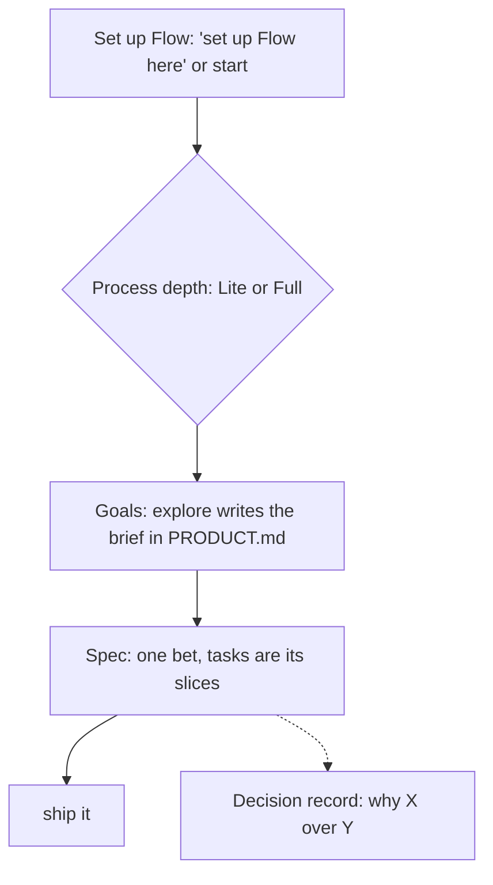

# Flow Skills

**From intent to verified software.** Portable [agent skills](https://agentskills.io) for [Flow](PRODUCT.md), a lightweight, human-led product engineering methodology. Talk to your agent, typed or dictated: "interview me", "spec it", "ship it". `flow` keeps product context aligned and sets up Flow in a project; the remaining skills are optional and independent, including `start` for new projects. No mandatory workflow or required changes to adopter instruction files. Skills may name the next skill and wait; the only automatic hand-offs are `start` → `explore` and explore's `interview` and `grill` phases, each behind the user's yes ([decision 0024](docs/decisions/0024-gated-hand-offs.md)).

[Flow identity and catalog scope](PRODUCT.md) · **[Skill catalog](docs/skills.md)** · [Methodology](docs/methodology.md) · [Documentation guide](docs/README.md)

## Install

```bash
npx skills add gaboesquivel/flow-skills
```

Choose agent and scope in the installer. [Agent compatibility](docs/agent-compatibility.md) covers other install paths and metadata limits.

## How it fits together



- **Set up Flow.** Say "set up Flow here" in an existing project, or "start a Next.js project" for a new one. `start` is the same setup plus a verified template bootstrap. Both write one removable Flow block into `AGENTS.md` and ask one question: **Lite** or **Full** process ([decision 0026](docs/decisions/0026-process-depth.md)).
- **Define the goals.** Every Flow project gets the same goals from `explore`: the problem, who it serves (agents included), the riskiest assumption, one main metric with a kill criterion, core journeys, and alternatives. `start` hands off to `explore` automatically; `flow` names it when `PRODUCT.md` has none.
- **Keep context aligned.** "Update the docs" has `flow` align `PRODUCT.md`, `DESIGN.md`, `GLOSSARY.md`, and `ARCHITECTURE.md` after meaningful changes.
- **Deliver.** "Spec it", "break it down", and "ship it" land a spec's tasks on one branch, through one pull request or a reviewed merge into local `main` ([decision 0020](docs/decisions/0020-flow-mode.md)).
- **Other skills.** Say what you want; each skill's leading word reaches it ("grill me", "build it"). Slash commands work too. No mandatory sequence.

### Lite or Full

| | Lite (default) | Full |
| --- | --- | --- |
| Discovery | Intent, riskiest assumption, kill criterion, main metric, journeys, alternatives | Lite plus pre-mortem, jobs to be done, competitors, 2–3 approaches, saved research |
| Specs | Spec 001 in full; later slices as `candidate` stubs | Same |
| Decisions | Inside each spec unless they pass the decision test | A decision record for every choice among alternatives, starting with the chosen approach |

Full records more of the *why*; it never specifies later slices up front, because those change once the first one ships. The choice is a `Process:` line in the Flow block; `explore` uses it as its default and you can override it per run.

### Specs, tasks, and decisions

- **Spec:** one bet. It tests one assumption and ships as one unit. A spec can be large.
- **Tasks:** the slices inside a spec, each verifiable on its own. Work that only makes sense after seeing how another bet did is a new spec, not another task.
- **Decision record:** written only when a choice picked among real alternatives *and* reaches beyond one spec or is costly to reverse. Everything else stays in the spec's Implementation Decisions.

Details and links to every `SKILL.md`: **[docs/skills.md](docs/skills.md)**.

## Catalog

| Group | Skills |
| --- | --- |
| Context alignment | `flow` |
| Delivery | `explore`, `interview`, `grill`, `to-spec`, `to-tasks`, `implement`, `review`, `ship`, `retro` |
| Advisory | `council` |
| Prototype | `prototype` |
| Shared language | `domain-modeling` |
| Quality | `debug` |
| Product discovery | `jtbd`, `competitors` |
| Writing | `write-agents`, `write-humans` |
| Project start | `start` |
| Misc | `tldr`, `handoff` |

Default durable docs in adopter projects: `docs/specs/NNN-short-name.md`, `docs/decisions/NNN-short-name.md` (or existing conventions).

## Influences and engineering philosophy

Flow builds on the work of engineers and teams who have advanced software engineering with AI agents. We study their methods, adapt what works, and maintain our own independent implementations.

| Influence | What we learn |
| --- | --- |
| [Matt Pocock](https://github.com/mattpocock/skills) | Clear agent instructions, leading words, progressive disclosure, and focused human alignment. |
| [Lauren Tan (poteto)](https://github.com/cursor/plugins/tree/main/pstack) | Rigorous engineering, root-cause prevention, blast-radius verification, architecture-first thinking, and independent adversarial review. |
| [Addy Osmani](https://github.com/addyosmani/agent-skills) | Production engineering discipline, maintainable code, practical specifications, and evidence-based delivery. |
| [Jesse Vincent (Superpowers)](https://github.com/obra/superpowers) | Test-driven skill development, systematic debugging, and regression testing of agent behavior. |
| [Anthropic Agent Skills](https://github.com/anthropics/skills) | Portable skill conventions, realistic evaluations, and measuring whether instructions improve agent behavior. |
| [Vercel Agent Skills](https://github.com/vercel-labs/agent-skills) | Focused engineering guidance, prioritized rules, concrete examples, and efficient skill packaging. |

### How Flow differs

Flow combines product thinking, engineering discipline, and verified execution without imposing a fixed sequence or orchestration runtime.

- **Human-led:** People retain control of consequential product and engineering decisions.
- **Minimal:** Use only the skills, documentation, and verification the work requires.
- **Portable:** Skills work independently across compatible agents, models, and interfaces.
- **Evidence-driven:** Tests and observed behavior matter more than confident claims.
- **Locally owned:** Flow maintains its own implementations, with attribution for adapted work.

We prefer preventing recurring mistakes through architecture, types, static checks, and tests before adding more instructions. We evaluate skills against realistic tasks, and simplify or remove instructions that do not improve outcomes.

Flow is not a fork of these methodologies. It is an independent, evolving approach shaped by practical use.

## Maintain

```bash
pnpm validate
pnpm test
```

[Release checks](docs/RELEASE.md) · [Attribution](ATTRIBUTION.md)
