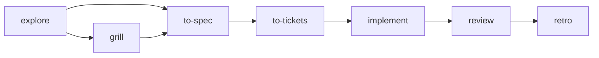

# Flow Skills

Portable, manually invoked [agent skills](https://agentskills.io) for product and engineering work. Install into the agent and interface you already use. No Flow initialization, workflow router, or changes to the adopter project's instruction files.

[Product direction](PRODUCT.md) · [Methodology](docs/methodology.md) · [Documentation guide](docs/README.md)

## Install

```bash
npx skills add gaboesquivel/flow-skills
```

The installer lets you choose a supported agent and installation scope. Flow does not ship a separate installer or bootstrap step.

Other hosts may import skills through their own UI or copy mechanism; use the Agent Skills CLI where it is supported. Hosts that cannot load standard skill packages need a manual copy; behavior then depends on that host.

## Invoke

Skills run only when you explicitly invoke them:

- Slash-command hosts: `/explore`, `/grill`, `/to-spec`, and the other skill names below.
- Skill-picker hosts: select the skill by name.
- Elsewhere: use that environment's explicit invocation mechanism.

`disable-model-invocation: true` expresses manual activation where hosts honor it. Enforcement varies by product; treat automatic skill picking as unsupported unless the host documents otherwise.

## Skills (12)

Each skill stands alone. Optional order for delivery work:



| Group | Skills |
| --- | --- |
| Delivery | `explore`, `grill`, `to-spec`, `to-tickets`, `implement`, `review`, `retro` |
| Product discovery | `interview`, `jtbd`, `competitors` |
| Writing | `write-agents`, `write-humans` |

Discovery skills are optional extensions for commercial and positioning questions. They do not gate delivery skills.

Default documentation for cross-discipline specs: `docs/specs/NNN-short-name.md`. Standalone decisions: `docs/decisions/NNN-short-name.md`. Adopter projects keep their own conventions when they differ.

[Agent compatibility](docs/agent-compatibility.md) summarizes installation, invocation, and metadata support across hosts.

## Maintain

```bash
pnpm validate
pnpm test
```

Edit `skills/` directly. Adapted material keeps [attribution and licenses](ATTRIBUTION.md). [Release checks](docs/RELEASE.md).
