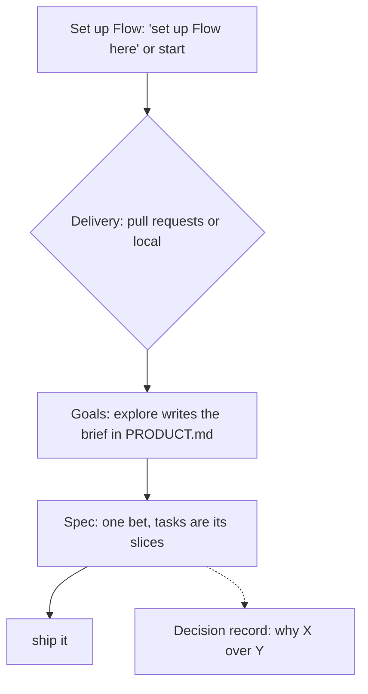
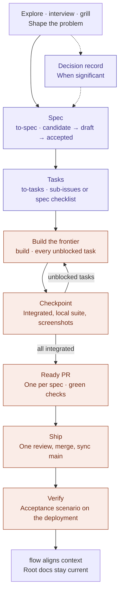

# Flow Skills

**From intent to verified software.** Portable [agent skills](https://agentskills.io) for [Flow](PRODUCT.md), a lightweight, human-led product engineering methodology. Talk to your agent, typed or dictated: "interview me", "spec it", "ship it". `flow` keeps product context aligned and sets up Flow in a project; the remaining skills are optional and independent, including `start` for new projects. No mandatory workflow or required changes to adopter instruction files. Skills may name the next skill and wait; the only automatic hand-offs are `start` → `explore` and explore's `interview` and `grill` phases, each behind the user's yes, and `ship` running `build` and `review` as part of landing ([decision 0028](docs/decisions/0028-build-and-ship.md); [decision 0024](docs/decisions/0024-gated-hand-offs.md)).

[Flow identity and catalog scope](PRODUCT.md) · **[Skill catalog](docs/skills.md)** · [Methodology](docs/methodology.md) · [Documentation guide](docs/README.md)

## Install

```bash
npx skills add gaboesquivel/flow-skills
```

Choose agent and scope in the installer. [Agent compatibility](docs/agent-compatibility.md) covers other install paths and metadata limits.

## How it fits together



- **Set up Flow.** Say "set up Flow here" in an existing project, or "start a Next.js project" for a new one. `start` is the same setup plus a verified template bootstrap. Both write one removable [Flow block](GLOSSARY.md#flow-block) into the instruction file Git tracks (`AGENTS.md`, or `CLAUDE.md` with an `@AGENTS.md` import when `AGENTS.md` is ignored) and ask one question: **Delivery**, pull requests or local ([decision 0030](docs/decisions/0030-asked-delivery-and-local-mode.md), [decision 0036](docs/decisions/0036-one-explore-depth.md)).
- **Define the goals.** Every Flow project gets the same goals from `explore`, at one default depth: the problem, who it serves (agents included), the riskiest assumption, a pre-mortem, one main metric with a kill criterion, core journeys, and alternatives. Ask for `competitors` or `jtbd` when you want deeper research. `explore` commits the brief on an `explore/<slug>` branch, which "spec it" turns into the spec branch. `start` hands off to `explore` automatically; `flow` names it when `PRODUCT.md` has none.
- **Keep context aligned.** "Update the docs" has `flow` align `PRODUCT.md`, `DESIGN.md`, `GLOSSARY.md`, and `ARCHITECTURE.md` after meaningful changes.
- **Deliver.** "Spec it" writes a draft spec with one acceptance scenario and publishes nothing; "accept the spec" approves it (in pull-request mode, opening the spec issue that copies it). "Break it down" makes its tasks (sub-issues of the spec issue in pull-request mode), "build it" runs every unblocked task at once on one branch and ends at one pull request per spec with green checks (local mode: reviewed and merged into local `main`, nothing pushed), and "ship it" lands accepted work with no confirmation (one independent review, green checks, merge; local mode: push `main`), then runs the spec's acceptance scenario on the shipped commit's deployment (decisions [0028](docs/decisions/0028-build-and-ship.md), [0029](docs/decisions/0029-spec-issues.md), and [0032](docs/decisions/0032-local-build-lands-ship-verifies.md)). A small fix with no spec skips that ceremony: "build it" runs the suite and one self-check, and a change too big for that stops for "spec it" ([unspecced work](GLOSSARY.md#unspecced-work)).
- **Other skills.** Say what you want; each skill's leading word reaches it ("grill me", "build it"). Slash commands work too. No mandatory sequence.

### Specs, tasks, and decisions

- **Spec:** one bet. It tests one assumption and ships as one unit. A spec can be large.
- **Tasks:** the slices inside a spec, each verifiable on its own. Work that only makes sense after seeing how another bet did is a new spec, not another task.
- **Decision record:** written only when a choice picked among real alternatives *and* reaches beyond one spec or is costly to reverse. Everything else stays in the spec's Implementation Decisions.

Details and links to every `SKILL.md`: **[docs/skills.md](docs/skills.md)**.

### From idea to shipped work

One path through Flow mode. Decision records are optional, written only for significant standalone choices; every step can also run on its own.



## Catalog

| Group | Skills |
| --- | --- |
| Context alignment | `flow` |
| Delivery | `explore`, `interview`, `grill`, `to-spec`, `to-tasks`, `build`, `review`, `ship`, `retro` |
| Advisory | `council` |
| Prototype | `prototype` |
| Shared language | `domain-modeling` |
| Quality | `debug` |
| Product discovery | `jtbd`, `competitors` |
| Writing | `write-agents`, `write-humans` |
| Project start | `start` |
| Misc | `tldr`, `handoff`, `board` |

Default durable docs in adopter projects: `docs/specs/NNN-short-name.md`, `docs/decisions/NNN-short-name.md` (or existing conventions).

## Influences and engineering philosophy

Flow builds on the work of engineers and teams who have advanced software engineering with AI agents. We study their methods, adapt what works, and maintain our own independent implementations.

| Influence | What we learn |
| --- | --- |
| [Matt Pocock](https://github.com/mattpocock/skills) | Clear agent instructions, leading words, progressive disclosure, and focused human alignment. |
| [Lauren Tan (poteto)](https://github.com/cursor/plugins/tree/main/pstack) | Rigorous engineering, root-cause prevention, blast-radius verification, architecture-first thinking, and independent adversarial review. |
| [Addy Osmani](https://github.com/addyosmani/agent-skills) | Production engineering discipline, maintainable code, practical specifications, and evidence-based delivery. |
| [Jesse Vincent (Superpowers)](https://github.com/obra/superpowers) | Test-driven skill development, systematic debugging, and regression testing of agent behavior. |
| [Anthropic Agent Skills](https://github.com/anthropics/skills) | Portable skill conventions, realistic evaluations, and measuring whether instructions improve agent behavior. |
| [Vercel Agent Skills](https://github.com/vercel-labs/agent-skills) | Focused engineering guidance, prioritized rules, concrete examples, and efficient skill packaging. |

### How Flow differs

Flow combines product thinking, engineering discipline, and verified execution without imposing a fixed sequence or orchestration runtime.

- **Human-led:** People retain control of consequential product and engineering decisions.
- **Minimal:** Use only the skills, documentation, and verification the work requires.
- **Portable:** Skills work independently across compatible agents, models, and interfaces.
- **Evidence-driven:** Tests and observed behavior matter more than confident claims.
- **Locally owned:** Flow maintains its own implementations, with attribution for adapted work.

We prefer preventing recurring mistakes through architecture, types, static checks, and tests before adding more instructions. We evaluate skills against realistic tasks, and simplify or remove instructions that do not improve outcomes.

Flow is not a fork of these methodologies. It is an independent, evolving approach shaped by practical use.

## Maintain

```bash
pnpm validate
pnpm test
```

[Release checks](docs/RELEASE.md) · [Attribution](ATTRIBUTION.md)
