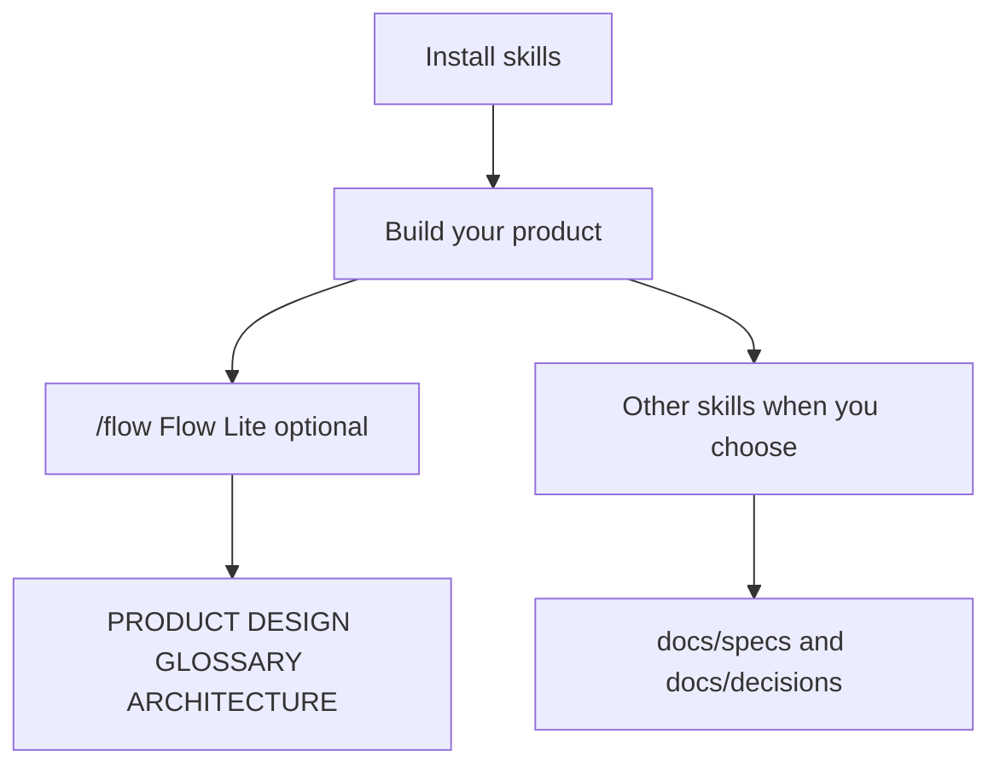

# Flow Skills

**From intent to verified software.** Portable [agent skills](https://agentskills.io) for [Flow](PRODUCT.md), a human-led product engineering methodology. **Flow Lite** keeps root context docs aligned; the rest of the catalog is optional and manually invoked. No setup command, workflow router, or changes to adopter instruction files.

[Flow identity and catalog scope](PRODUCT.md) · **[Skill catalog](docs/skills.md)** · [Methodology](docs/methodology.md) · [Documentation guide](docs/README.md)

## Install

```bash
npx skills add gaboesquivel/flow-skills
```

Choose agent and scope in the installer. [Agent compatibility](docs/agent-compatibility.md) covers other install paths and metadata limits.

## How it fits together



- **`flow` (Flow Lite)** — align root context documents after meaningful changes. Hosts may surface it when supported; it is not a pipeline.
- **Other skills** — invoke explicitly (`/explore`, `/to-spec`, `/implement`, …). Each is independent; no mandatory sequence.

Details and links to every `SKILL.md`: **[docs/skills.md](docs/skills.md)**.

## Catalog (14)

| Group | Skills |
| --- | --- |
| Flow Lite | `flow` |
| Delivery | `explore`, `grill`, `to-spec`, `to-tickets`, `implement`, `review`, `retro` |
| Product discovery | `interview`, `jtbd`, `competitors` |
| Writing | `write-agents`, `write-humans` |
| Misc | `tldr` |

Default durable docs in adopter projects: `docs/specs/NNN-short-name.md`, `docs/decisions/NNN-short-name.md` (or existing conventions).

## Maintain

```bash
pnpm validate
pnpm test
```

[Release checks](docs/RELEASE.md) · [Attribution](ATTRIBUTION.md)
