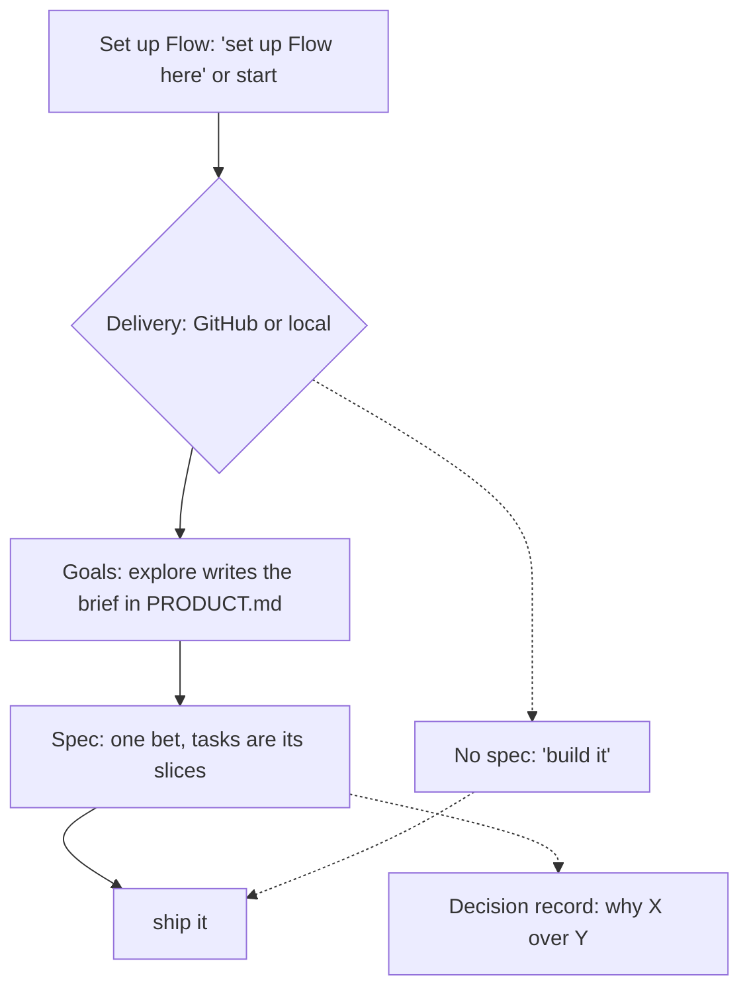
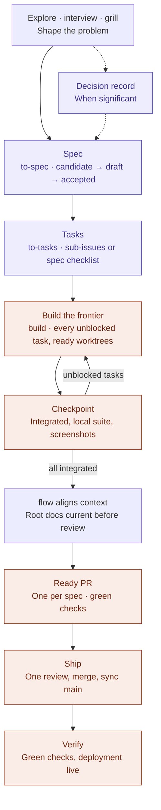

# Flow Skills

**From intent to verified software.** Portable [agent skills](https://agentskills.io) for [Flow](PRODUCT.md), a lightweight, human-led product engineering methodology. You talk to your agent, typed or dictated: "interview me", "spec it", "ship it". Each phrase reaches one skill. Nothing runs unless you ask, and you can use one skill, all of them, or none.

[Flow identity and catalog scope](PRODUCT.md) · **[Skill catalog](docs/skills.md)** · [Methodology](docs/methodology.md) · [Documentation guide](docs/README.md)

## Install

```bash
npx skills add gaboesquivel/flow-skills
```

Choose your agent and install scope in the installer. [Agent compatibility](docs/agent-compatibility.md) covers other install paths and metadata limits. Flow needs no changes to your instruction files; setting up Flow mode adds one removable block, and only when you ask.

## Flow is Git-based

Flow keeps its work in Git: specs, decision records, and the product brief are files committed on branches, and delivery is branches and merges. What you need depends on what you use ([requirements](PRODUCT.md#install-and-catalog), [decision 0037](docs/decisions/0037-git-for-delivery-github-for-github-mode.md)):

| You use | You need |
| --- | --- |
| Thinking skills: `grill`, `interview`, `council`, `debug`, `tldr`, the writing skills, and the rest | Nothing. Any folder works, with or without Git. |
| The delivery chain: `flow`'s setup, `start`, `explore`, `to-spec`, `to-tasks`, `build`, `review`, `ship`, `board` | A Git repository. Outside one, the skill offers `git init` and stops if you say no. |
| GitHub mode | GitHub access as well: spec issues, sub-issues, pull requests, and preview deployments live there. |

The rules Flow follows in a project live in Git too. "Set up Flow here" writes one [Flow block](GLOSSARY.md#flow-block) into the instruction file Git tracks: `AGENTS.md`, or `CLAUDE.md` with an `@AGENTS.md` import when `AGENTS.md` is ignored. The block records your delivery mode and the phrase table, and every agent and teammate who clones the repository reads the same rules. Delete the block to opt out.

## Local or GitHub delivery

The first time a delivery skill needs to know, Flow asks one question: **GitHub or local?** The answer is saved as the block's `Delivery:` line. Both modes use the same skills and phrases; they differ in where the work is tracked and how it lands.

| | Local | GitHub |
| --- | --- | --- |
| Needs | Git only. Works with GitLab, Bitbucket, or no remote at all. | Git plus a GitHub repository and access to it. |
| Spec | A file on its feature branch. | The same file, plus a [spec issue](GLOSSARY.md#spec-issue) that copies it, opened when you accept the spec. |
| Tasks | A checklist in the spec's Tasks section. | The same checklist, plus sub-issues of the spec issue with blocking links. |
| "Build it" | Runs the checks and the review, then merges the work's branch into your local `main`. Nothing is pushed. | Runs the checks and opens one pull request for the work with green CI. |
| "Ship it" | Pushes `main` when a remote exists. | Reviews the pull request, waits for green checks, and merges it. |
| Verification | Checks that the pushed commit is green and its deployment answers, or reports "deployment unverified" when there is none. | The same, on the merge commit. |

Pick local when you work alone, use another Git host, or want nothing published. Pick GitHub when your team reviews in pull requests or your default branch requires them; Flow detects that protection and uses GitHub mode without asking. To use the other mode for one run, say so: "build it local" or "ship it with GitHub". The full rule lives in [`build`](skills/build/SKILL.md#delivery-mode); the glossary defines [delivery mode](GLOSSARY.md#delivery-mode).

## Work without a spec

Specs are for bets worth tracking, not a toll on every change. In either mode, nothing writes a spec or tasks unless you say "spec it" or "break it down" ([decision 0039](docs/decisions/0039-build-never-requires-a-spec.md)).

- **Say "build it".** With no spec behind it, `build` treats the change as [unspecced work](GLOSSARY.md#unspecced-work). It runs your full check suite, then picks the review: one self-check for a small fix, or the full independent review when its [size guard](skills/build/SKILL.md#unspecced-work) flags a larger or riskier change. Then it lands the work the way your mode does: a merge into local `main`, or a ready pull request. "Ship it" verifies it.
- **Explore, then build.** After "explore this", "build it" builds the confirmed brief directly. The `explore/<slug>` branch becomes the work branch and the brief lands with the code. For a new product, `explore` stops at the brief; spec 001 comes only when you ask. `explore` skips fixes and clearly small changes entirely: no questions, no writes.
- **Build locally where pull requests are required.** "Build it local" on a repository whose default branch requires pull requests commits the work on a branch and stops: no push, no pull request. "Ship it" opens the pull request when you are ready.
- **Just ask your agent.** Flow skills run when your request matches their phrases. A plain request ("rename this prop") is handled as your agent would without Flow.

## How it fits together



- **Set up Flow.** Say "set up Flow here" in an existing project, or "start a Next.js project" for a new one. `start` is the same setup plus a verified template bootstrap. Both write the Flow block and ask only the delivery question ([decision 0030](docs/decisions/0030-asked-delivery-and-local-mode.md), [decision 0036](docs/decisions/0036-one-explore-depth.md)).
- **Define the goals.** `explore` gives every Flow project the same goals at one default depth: the problem, who it serves (agents included), the riskiest assumption, a pre-mortem, one main metric with a kill criterion, core journeys, and alternatives. Ask for `competitors` or `jtbd` when you want deeper research. `explore` commits the brief on an `explore/<slug>` branch, which "spec it" turns into the spec branch. `start` hands off to `explore` automatically; `flow` names it when `PRODUCT.md` has no brief.
- **Keep context aligned.** "Update the docs" has `flow` align `PRODUCT.md`, `DESIGN.md`, `GLOSSARY.md`, and `ARCHITECTURE.md` after meaningful changes.
- **Deliver.** "Spec it" writes a draft spec with one acceptance scenario and publishes nothing; "accept the spec" approves it. "Break it down" makes its tasks. "Build it" runs every unblocked task at once on one branch and delivers the spec as your mode does. "Ship it" lands accepted work with no confirmation, then checks that the shipped commit is green and its deployment answers (decisions [0028](docs/decisions/0028-build-and-ship.md), [0029](docs/decisions/0029-spec-issues.md), [0032](docs/decisions/0032-local-build-lands-ship-verifies.md), and [0040](docs/decisions/0040-ship-verifies-liveness.md)).
- **Other skills.** Say what you want; each skill's leading word reaches it ("grill me", "debug this"). Slash commands work too. There is no mandatory sequence.

Skills may name the next skill and wait for you. The only automatic hand-offs are `start` → `explore`, explore's `interview` and `grill` phases (each behind your yes), and `ship` running `build` and `review` as part of landing ([decision 0024](docs/decisions/0024-gated-hand-offs.md), [decision 0028](docs/decisions/0028-build-and-ship.md)).

### Specs, tasks, and decisions

- **Spec:** one bet. It tests one assumption and ships as one unit. A spec can be large.
- **Tasks:** the slices inside a spec, each verifiable on its own. Work that only makes sense after seeing how another bet did is a new spec, not another task.
- **Decision record:** written only when a choice picked among real alternatives *and* reaches beyond one spec or is costly to reverse. Everything else stays in the spec's Implementation Decisions.

Details and links to every `SKILL.md`: **[docs/skills.md](docs/skills.md)**.

### From idea to shipped work

The full path for a spec. Decision records are optional, and every step can also run on its own.



## Catalog

| Group | Skills |
| --- | --- |
| Context alignment | `flow` |
| Delivery | `explore`, `interview`, `grill`, `to-spec`, `to-tasks`, `build`, `review`, `ship`, `retro` |
| Advisory | `council` |
| Prototype | `prototype` |
| Shared language | `domain-modeling` |
| Quality | `debug` |
| Product discovery | `jtbd`, `competitors` |
| Writing | `write-agents`, `write-humans` |
| Project start | `start` |
| Misc | `tldr`, `handoff`, `board` |

Default durable docs in adopter projects: `docs/specs/NNN-short-name.md`, `docs/decisions/NNN-short-name.md` (or existing conventions).

## Influences and engineering philosophy

Flow builds on the work of engineers and teams who have advanced software engineering with AI agents. We study their methods, adapt what works, and maintain our own independent implementations.

| Influence | What we learn |
| --- | --- |
| [Matt Pocock](https://github.com/mattpocock/skills) | Clear agent instructions, leading words, progressive disclosure, and focused human alignment. |
| [Lauren Tan (poteto)](https://github.com/cursor/plugins/tree/main/pstack) | Rigorous engineering, root-cause prevention, blast-radius verification, architecture-first thinking, and independent adversarial review. |
| [Addy Osmani](https://github.com/addyosmani/agent-skills) | Production engineering discipline, maintainable code, practical specifications, and evidence-based delivery. |
| [Jesse Vincent (Superpowers)](https://github.com/obra/superpowers) | Test-driven skill development, systematic debugging, and regression testing of agent behavior. |
| [Anthropic Agent Skills](https://github.com/anthropics/skills) | Portable skill conventions, realistic evaluations, and measuring whether instructions improve agent behavior. |
| [Vercel Agent Skills](https://github.com/vercel-labs/agent-skills) | Focused engineering guidance, prioritized rules, concrete examples, and efficient skill packaging. |

### How Flow differs

Flow combines product thinking, engineering discipline, and verified execution without imposing a fixed sequence or orchestration runtime.

- **Human-led:** People retain control of consequential product and engineering decisions.
- **Minimal:** Use only the skills, documentation, and verification the work requires.
- **Portable:** Skills work independently across compatible agents, models, and interfaces.
- **Evidence-driven:** Tests and observed behavior matter more than confident claims.
- **Locally owned:** Flow maintains its own implementations, with attribution for adapted work.

We prefer preventing recurring mistakes through architecture, types, static checks, and tests before adding more instructions. We evaluate skills against realistic tasks, and simplify or remove instructions that do not improve outcomes.

Flow is not a fork of these methodologies. It is an independent, evolving approach shaped by practical use.

## Maintain

```bash
pnpm validate
pnpm test
```

[Release checks](docs/RELEASE.md) · [Attribution](ATTRIBUTION.md)
