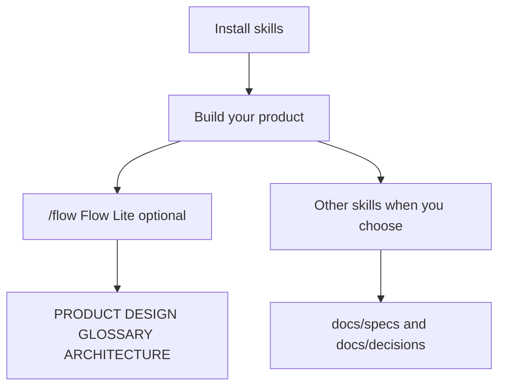

# Flow Skills

**From intent to verified software.** Portable [agent skills](https://agentskills.io) for [Flow](PRODUCT.md), a lightweight, human-led product engineering methodology. Flow Lite keeps product context aligned; the remaining skills are optional and independently invoked, including `start` for new projects. No mandatory workflow, agent router, or required changes to adopter instruction files.

[Flow identity and catalog scope](PRODUCT.md) · **[Skill catalog](docs/skills.md)** · [Methodology](docs/methodology.md) · [Documentation guide](docs/README.md)

## Install

```bash
npx skills add gaboesquivel/flow-skills
```

Choose agent and scope in the installer. [Agent compatibility](docs/agent-compatibility.md) covers other install paths and metadata limits.

## How it fits together



- **`flow` (Flow Lite)** — align the current project's root context after meaningful changes. Hosts may surface it when supported; it is not a pipeline and not initialization.
- **Other skills** — invoke explicitly (`/explore`, `/to-spec`, `/implement`, …). Each is independent; no mandatory sequence.

Details and links to every `SKILL.md`: **[docs/skills.md](docs/skills.md)**.

## Catalog (15)

| Group | Skills |
| --- | --- |
| Flow Lite | `flow` |
| Delivery | `explore`, `grill`, `to-spec`, `to-tickets`, `implement`, `review`, `retro` |
| Product discovery | `interview`, `jtbd`, `competitors` |
| Writing | `write-agents`, `write-humans` |
| Project start | `start` |
| Misc | `tldr` |

Default durable docs in adopter projects: `docs/specs/NNN-short-name.md`, `docs/decisions/NNN-short-name.md` (or existing conventions).

## Influences and engineering philosophy

Flow builds on the work of engineers and teams who have advanced software engineering with AI agents. We study their methods, adapt what works, and maintain our own independent implementations.

| Influence | What we learn |
| --- | --- |
| [Matt Pocock](https://github.com/mattpocock/skills) | Clear agent instructions, leading words, progressive disclosure, and focused human alignment. |
| [Lauren Tan (poteto)](https://github.com/cursor/plugins/tree/main/pstack) | Rigorous engineering, root-cause prevention, blast-radius verification, architecture-first thinking, and independent adversarial review. |
| [Addy Osmani](https://github.com/addyosmani/agent-skills) | Production engineering discipline, maintainable code, practical specifications, and evidence-based delivery. |
| [Jesse Vincent (Superpowers)](https://github.com/obra/superpowers) | Test-driven skill development, systematic debugging, and regression testing of agent behavior. |
| [Anthropic Agent Skills](https://github.com/anthropics/skills) | Portable skill conventions, realistic evaluations, and measuring whether instructions improve agent behavior. |
| [Vercel Agent Skills](https://github.com/vercel-labs/agent-skills) | Focused engineering guidance, prioritized rules, concrete examples, and efficient skill packaging. |

### How Flow differs

Flow combines product thinking, engineering discipline, and verified execution without imposing a fixed sequence or orchestration runtime.

- **Human-led:** People retain control of consequential product and engineering decisions.
- **Minimal:** Use only the skills, documentation, and verification the work requires.
- **Portable:** Skills work independently across compatible agents, models, and interfaces.
- **Evidence-driven:** Tests and observed behavior matter more than confident claims.
- **Locally owned:** Flow maintains its own implementations, with attribution for adapted work.

We prefer preventing recurring mistakes through architecture, types, static checks, and tests before adding more instructions. We evaluate skills against realistic tasks, and simplify or remove instructions that do not improve outcomes.

Flow is not a fork of these methodologies. It is an independent, evolving approach shaped by practical use.

## Maintain

```bash
pnpm validate
pnpm test
```

[Release checks](docs/RELEASE.md) · [Attribution](ATTRIBUTION.md)
