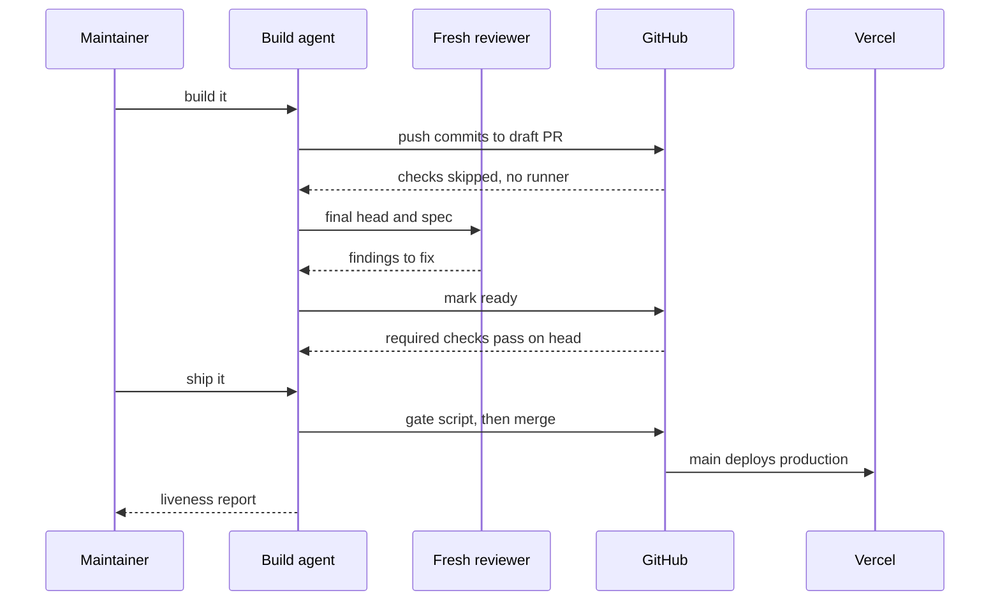

# What counts as verified delivery?

When a coding agent says a change is done, it could mean several things. The code compiles. The tests passed, on some commit. A deployment exists. The feature does what was asked. Users are better off. These are different claims with different evidence, and an agent's summary tends to blur them into one confident sentence.

Flow's answer is to make each step of a delivery leave evidence that names the commit it applies to, and to keep the claims separate in the report. This article follows one real change through those steps: [spec 048](../specs/048-delivery-lifecycle.md), which changed how this repository runs checks on pull requests. The rules themselves live in the skills and decisions linked throughout; this article explains them and defines nothing new. The capability page [Intent-to-verified delivery](../capabilities/verified-delivery.md) summarizes the practice.

## The intent: stop paying for checks nobody uses

The problem spec 048 set out to fix was cost without evidence. Every push to a pull request ran the full check suite, drafts included, and Vercel built a preview for every branch push. The spec counted 39 of 54 recent deployments of this repository as previews. Most of those runs verified commits nobody would ever merge.

The intended outcome was specific: one draft pull request per spec as the shared workspace, no CI and no automatic preview while it is a draft, the required checks run once when it is marked ready, and a merge only when those checks actually ran and passed on the head being merged. The rationale is recorded in [decision 0057](../decisions/0057-draft-workspace-ready-checks.md).

The spec also wrote an acceptance scenario: ten numbered steps, each with an observable result, such as "the CI and `pr-title` jobs report `skipped` with no runner time." Those steps are what review later judges.

**Appetite.** Spec 048 did not record an appetite. The practice of recording one for substantial work ([decision 0053](../decisions/0053-delivery-appetite-and-scope.md)) was accepted on 2026-10-31, the day this change merged, and the spec itself states that savings stay "not yet measured" until a comparable window has passed. *Illustrative extension, not part of the record:* under current guidance, a spec like this would carry a short Appetite section naming a time target, its first verifiable slice (for example, draft runs skipping in this repository alone), and what gives way if it overruns, such as the starter repositories. [Scope and cost control](../capabilities/scope-cost-control.md) explains why that is a target and not a cap.

## Implementation: a draft workspace

"Build it" opened one draft pull request, [#208](https://github.com/gaboesquivel/flow-skills/pull/208), on the branch `spec/048-delivery-lifecycle`. The configuration it introduced is small:

- [`ci.yml`](../../.github/workflows/ci.yml) and [`pr-title.yml`](../../.github/workflows/pr-title.yml) trigger on `ready_for_review` as well as the usual pull request events, and skip their jobs while the pull request is a draft.
- [`site/vercel.json`](../../site/vercel.json) turns off branch deployments except `main`, so production still deploys from the default branch and previews become an explicit request.

The pull request records what happened next. The first commit, made before the configuration changed, ran CI and built a preview. The four commits pushed after it reported CI and title checks as `skipped`, with no runner and no deployment. One commit came from a worker in a separate worktree and local branch; the integration owner merged it into the delivery branch, so no extra remote branch or pull request appeared. The rules for that were in [`build`](../../skills/build/SKILL.md) and [`write-agents` Sessions](../../skills/write-agents/SKILL.md#sessions) at the time; Claude Code now manages worktrees and sessions ([decision 0062](../decisions/0062-claude-code-first.md)).

While the work is a draft, the only signal is local. `build` runs focused checks as it goes and leaves the full suite for the final head.

## Review: a second reader on the head you hand over

Before marking the pull request ready, a reviewer in a fresh context read the change against the spec. It found two blocking problems: the REST API cannot mark a pull request ready, and, without active branch protection, the merge gate could pass a workflow that never ran. Both were fixed in one round, in the commit that became the final head.

Review rules have since tightened. [Decision 0058](../decisions/0058-review-passes-and-risk-tiers.md) makes a fresh-context review part of every build, sets its effort by risk, and caps the loop at three rounds. A change to workflow files like this one is now human tier: `ship` lands it only after you say yes to a report that lists those paths. See [`review`](../../skills/review/SKILL.md) and `build`'s [Size guard](../../skills/build/SKILL.md#size-guard).

## Checks: only results that actually ran

Marking the pull request ready ran the repository's two pull request checks on its final head, and both succeeded: `validate (ubuntu-latest, 22)` and `pr-title`. That head also carries `skipped` results from the draft-time runs. This is the subtle part.

GitHub records a job skipped by a condition as a check run with conclusion `skipped`, and branch protection can count that as passing. So `ship` does not rely on the summary. It runs [`required-checks.mjs`](../../skills/ship/scripts/required-checks.mjs), which reads the required checks for the pull request and their latest results on its head, and exits 0 only when the pull request is not a draft and each one succeeded. Skipped, neutral, cancelled, pending, missing, and stale results all stop the merge.

The gate needed one more fix after it shipped. In the `flow-next` starter repository, marking a pull request ready straight after opening it fired both events together, and the skipped draft run got the newer id, so the gate reported a check as skipped even though a real run had passed. [#211](https://github.com/gaboesquivel/flow-skills/pull/211) changed the script so a skipped run never hides a real result on the same head, with a test written first. A gate that fails closed is annoying in that moment; it is still the right direction to fail.

The sequence above shows the hand-offs in order. You approve the build. The agent pushes commits to a draft pull request, and GitHub skips the checks without using a runner. A fresh reviewer reads the final head against the spec and returns findings, which the agent fixes. Marking the pull request ready makes GitHub run the required checks on that head. When you say "ship it", the agent runs the gate script and merges only if every required check succeeded on that head. The merge to `main` triggers Vercel's production deployment, and the agent reports liveness back to you.

## Liveness: a report, not a verdict

After landing, [liveness](../../GLOSSARY.md#liveness) answers a narrow question: is the commit on the remote, and did the host's deployment for it come up and answer? It reports one of `live`, `pushed, no deployment reported`, `reachable, commit unconfirmed`, `not live`, or `unverified`. It never gates, rolls back, or runs the acceptance scenario. Behavior is review's job; [`ship`](../../skills/ship/SKILL.md) owns the rule.

Pull request #208 merged on 2026-10-31 and noted that the production deployment would be checked at ship time. Its record and the follow-up [#213](https://github.com/gaboesquivel/flow-skills/pull/213), which marked the spec implemented, do not state the liveness result for this repository's merge, so this article does not claim one. #213 does record that a production deploy in the `flow-next` starter was rate limited.

## Where scope and human control fit

Two boundaries ran through this delivery without much ceremony.

Scope: spec 048 named what it would not do, including re-enabling GitHub rulesets and changing a repository that needs its own work first. Those stayed out.

Human control: "build it" and "ship it" were the approvals. Steps they cover did not prompt again, while what they never cover (force-pushes, weakened checks, protection bypasses) stayed off the table. One limit was stated openly: the repository's "Flow main" ruleset was disabled, so GitHub itself would not block a failing merge. The pull request listed it as unresolved, and `ship`'s script held the line instead. A script that stops one agent is not branch protection. [Security and human control](../capabilities/security-human-control.md) covers where real enforcement comes from.

## What this does and does not prove

Put together, the delivery left three kinds of evidence, each tied to a commit: acceptance steps judged in review, findings fixed and answered, and required checks that ran and passed on the merged head. A liveness report is the fourth kind Flow expects after landing; this record does not contain one, as noted above. Together they are what Flow means by verified delivery.

It does not prove the change was worth making. Whether skipping draft CI saved meaningful time or money was not measured; the spec says so. Checks prove only what they test, and a reviewer can miss what the author missed. The draft-skipping workflows and disabled previews are this repository's configuration, not something Flow does for every adopter. A project that wants the same behavior configures its own workflows and hosting.

The value of the practice is that each of those limits is written down next to the evidence, instead of disappearing into "done."
