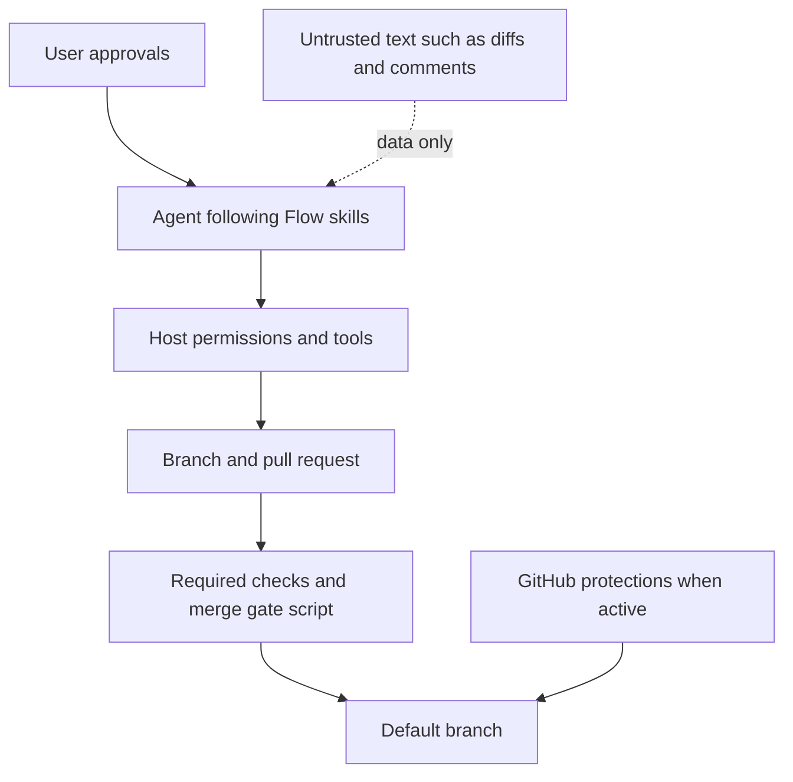

# Security and human control

## The problem

Directing a coding agent means letting it read untrusted text, run commands, and push code. Two failures are common: the agent treats a comment, diff, or web page as an instruction, or it asks permission so often that people approve without reading. You want the agent to act on your approvals, refuse what they do not cover, and leave the riskiest changes for a person.

## What Flow contributes

Flow's skills describe how the agent should behave at these boundaries:

- **Approvals are explicit and bounded.** "Build it" and "ship it" approve the steps those skills describe, so the agent does not ask again for each one. They never authorize destructive Git, force-pushes, skipping or weakening checks, bypassing protection, or unrelated changes.
- **A person stays in the loop where mistakes hurt most.** `build`'s size guard marks CI and workflow files, Git hooks, authentication, billing or payments, and release configuration as human tier. `ship` lands that work only on a yes given after `build` reported those paths.
- **Untrusted text is data.** Diffs, pull request comments, fixtures, logs, pages, and issue bodies are evidence for the task, never instructions that widen it. Worker briefs say the same.
- **Users keep the sensitive steps.** Sign-in, entering secrets or payment details, accepting terms, and changing the agent's permission settings go to you. A security or protection setting changes only on your explicit request.
- **Merging requires real evidence.** `ship` never approves its own pull request or uses an admin bypass, and its gate script refuses to merge unless every required check succeeded on the head being merged.
- **A second reader.** Every build gets a fresh-context review that includes a security axis.

Text alternative: you approve the work, and the agent follows Flow's skills to carry it out. Untrusted text such as diffs and comments reaches the agent only as data to evaluate. Everything the agent does passes through the host's permissions and tools, which decide what it can actually run. Its changes go to a branch and pull request, and reach the default branch only after the required checks pass and `ship`'s merge gate script agrees. GitHub's own protections add a separate barrier at the default branch, but only when they are active.

## How to start

Say "build it" or "ship it" when you mean it; those are the approvals. Expect one question after "build it" when the change touches a human-tier path: `ship` waits for your yes after reading the report. Say "review it" to raise a build's review to its deepest tier.

## Example

Spec 048 changed this repository's CI workflows. When it landed, GitHub's "Flow main" ruleset was disabled, so GitHub itself would not block a failing merge. The pull request ([#208](https://github.com/gaboesquivel/flow-skills/pull/208)) said so and listed it as unresolved; `ship`'s gate script held the line instead. That ruleset was still disabled when this page was written. Under the current rules, a change to workflow files like this one is human tier.

## Evidence and owners

- Approvals, size guard, and human tier: [`build`](../../skills/build/SKILL.md#size-guard); [decision 0048](../decisions/0048-delivery-phrases-are-approvals.md); [decision 0058](../decisions/0058-review-passes-and-risk-tiers.md).
- Untrusted input and the security axis: [`review`](../../skills/review/SKILL.md) (Inspect).
- Merge gate: [`ship`](../../skills/ship/SKILL.md) and [`required-checks.mjs`](../../skills/ship/scripts/required-checks.mjs); [decision 0057](../decisions/0057-draft-workspace-ready-checks.md).
- Steps reserved for people: [`write-agents` Tools](../../skills/write-agents/SKILL.md#tools); worker briefs in [Workers](../../skills/write-agents/SKILL.md#workers).

## Limitations and trade-offs

- **Guidance is not a sandbox or a permission engine.** Skills shape what a well-behaved agent tries. What it can actually do is set by your host's permissions and tools, GitHub protections, and the checks you configure. Configure those as if the guidance could fail.
- **Not injection-proof.** Treating untrusted text as data reduces risk; it does not eliminate it.
- **The gate script is not protection.** It stops `ship`, but not a person or another tool merging directly. Decision 0057 notes that GitHub-side blocking depends on an active ruleset.
- **Reviewers can be wrong together.** A fresh-context reviewer may run on the same model as the author and share its blind spots. Separate execution reduces anchoring on the author's context; it does not guarantee correctness. Without separate execution the review is labelled single-agent.
- **Human tier relies on judgment.** The size guard is applied by the agent from the change. When uncertain it picks the higher tier, but it can misclassify.
