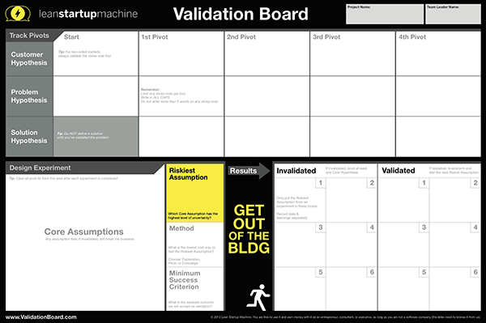

# Agentic validation board and readiness

Reviewed 2026-10-19. The user wants to adapt the essence of the Lean Startup Machine Validation Board for agents and humans. Board implementation is not yet designed.

## Board reference

The supplied image connects customer, problem, and solution hypotheses to core assumptions, the riskiest assumption, a method, minimum success criteria, results, and pivots. Grace Ng's account explains the importance of identifying risky assumptions and defining success before experimentation.

Established direction: Markdown for agents and a dynamic human view should represent the same information.

Implementation proposals: use one underlying record and keep evidence provenance, including whether feedback comes from humans, actual agent tasks, simulations, or system telemetry. Preserve inconclusive results rather than forcing every result into validated/invalidated. Schema, synchronization, and rendering remain open. The image is a reference, not an adopted visual design.

[Grace Ng: Why Lean Startup Experiments are Hard to Design](https://www.lean.org/the-lean-post/articles/why-lean-startup-experiments-are-hard-to-design/)

## Is Agentic

The user confirmed is-agentic.com as the intended reference. Its methodology assesses public website agent readiness and explicitly excludes compliance certification. Individual applicable checks matter more than a universal score target. Its developer documentation covers API, CLI, and MCP access to reports.

- [Methodology](https://is-agentic.com/methodology)
- [Developer documentation](https://is-agentic.com/docs)

No scan was run. Flow's applicable checks and acceptance criteria remain open.

## Persona feedback

The speculative skill is retained in [ideas](../ideas/README.md). The supplied [LinkedIn reference](https://www.linkedin.com/posts/illaigescheit_tomorrow-i-will-present-some-of-the-concepts-share-7497608709372571648-zbpp/) was inaccessible, so no conclusions are attributed to it.
