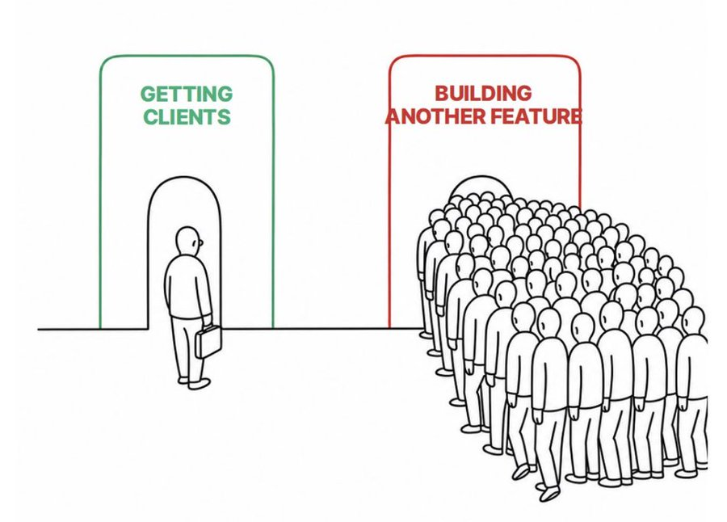

# Iteration and documentation refinement

Reviewed 2026-10-19. Current direction is in [principles](../principles.md) and [methodology](../methodology.md). This note preserves source context and exploratory proposals.

## Iteration velocity

In the First Round interview, Guillermo Rauch distinguishes iteration velocity from speed: direction can be known or deliberately sought. He describes customer conversations, understanding feedback, and building less as ways of improving progress. Flow adapts this into initiative-level intent, assumptions, and feedback; that specific convention is Flow's synthesis, not a quoted Rauch framework.

Source: https://review.firstround.com/podcast/how-vercel-found-extreme-product-market-fit-by-focusing-on-simplification-guillermo-rauch-vercels-ceo/

## Open implementation ideas

- An initiative document could contain intent, assumption, existing evidence, validation approach, scope, decision criteria, and findings. The format is not settled; it need not force a new document for every experiment.
- The later [validation-board direction](2026-10-19-agentic-validation-board.md) supersedes the earlier open canvas proposal. A separate business canvas remains undecided.
- Refinement could be one entry point composing questioning, research, and exploration. Independent invocation and names remain undecided.
- The methodology-learning skill could explain Flow and its influences. Whether it also answers project-specific product and architecture questions remains open.

## Illustration

User-supplied illustration of feature-building displacing customer work. Original creator and source have not been established. Retained here as supporting material rather than part of the product definition.
