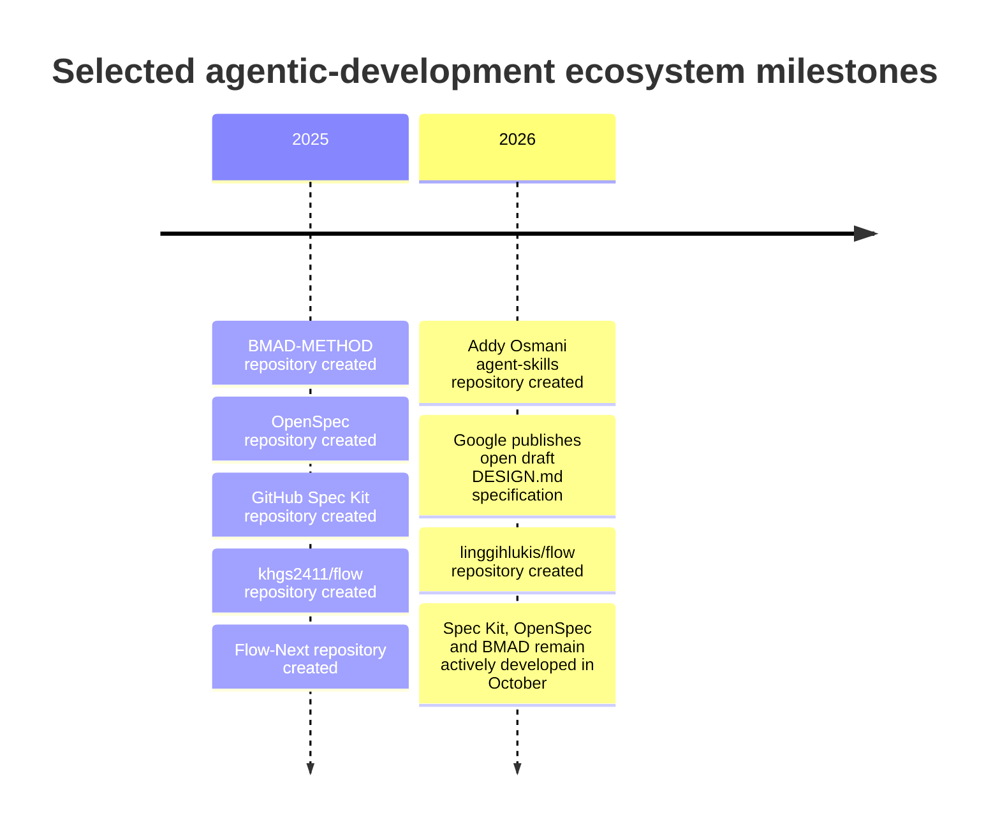
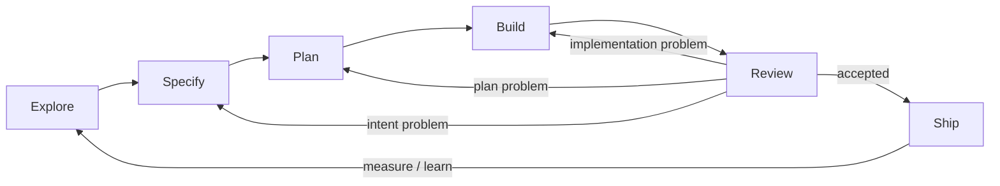

# Flow Skills Competitive Landscape and Differentiation

Status: imported research dated 2026-10-20; claims not independently reverified during cleanup. Recommendations, including tables labeled ADOPT or REJECT, are proposals—not Flow decisions. The report assumes a fixed lifecycle that current Flow documentation does not adopt. Original session citation tokens cannot be resolved from this repository; direct source links are retained for later verification. Current authority: [PRODUCT.md](../../PRODUCT.md) and the [documentation guide](../README.md).

## Executive assessment and research method

The research brief supplied through the connector defines **Flow Skills** as a planned open-source methodology and portable skill set for Agentic Product Engineers, solo founders, and small technical teams, centered on **Explore → Specify → Plan → Build → Review → Ship**, with continuous alignment among product intent, decisions, documentation, and implementation. It also makes clear that Flow Skills is still in the research/design phase, so this report treats proposed capabilities as targets rather than existing features. fileciteturn0file0

**Research assumptions.** The initial request described the topic as unspecified, but the connector payload resolves it to the Flow Skills competitive-landscape question, so the generic technology/health/policy topic-selection fallback is unnecessary. The audience remains unspecified, so I assume an informed professional audience familiar with software development and AI coding agents. The requested length is treated as roughly a 6–12 page analytical report. Citation style is inline source attribution plus a consolidated reference list. Research is current through **October 20, 2026**, with primary repositories, source files, official documentation, and first-party methodology sources prioritized.

**Bottom line:** Flow Skills has a credible opportunity, but **the broad thesis is not differentiated enough yet**. “Spec-driven development,” “persistent repository context,” “agent skills,” “plan-before-code,” “verification,” “brownfield support,” and even fairly complete development lifecycles are already well covered. GitHub Spec Kit now describes a core **Specify → Plan → Tasks → Implement → Converge** process; OpenSpec combines exploration, proposals/specifications, design, implementation, verification, and archival; Addy Osmani’s agent-skills organize a very similar **Define → Plan → Build → Verify → Review → Ship** lifecycle; BMAD explicitly spans product analysis through architecture and implementation; and several projects named Flow already concentrate on project memory, specifications, execution state, and continuity. fileciteturn11file14 fileciteturn12file2 fileciteturn19file0 citeturn21search0

The most promising white space is therefore narrower:

> **Flow Skills should aim to become a lean, portable product-to-code alignment protocol: a way to preserve the chain from evidence and product intent, through consequential decisions and implementation contracts, to verified code and post-ship learning.**

That differs materially from merely adding another spec-driven coding workflow. It places the highest value at the *interfaces* where other systems often become lossy: external evidence → product intent; intent → design/architecture decisions; decisions → change specification; specification → implementation; implementation → durable documentation; and shipped behavior → updated product learning.

That position is defensible only if Flow operationalizes three things competitors usually cover separately:

| Dimension | What Flow would need to do unusually well | Current competitive reality |
|---|---|---|
| **Product** | Establish whether a problem is worth solving using explicit evidence, assumptions, outcomes, and experiments—not merely turn an idea into a PRD. | ProductSkills and other PM skill libraries are strong here; general coding methodologies are typically shallower. citeturn13search0turn13search2turn22search1 |
| **Engineering** | Translate decided intent into bounded, verifiable implementation while composing with specialist coding/testing skills. | This is already crowded and mature: Spec Kit, OpenSpec, Superpowers, Addy’s skills, Flow-Next, Archon, and linggihlukis/flow all address significant portions. fileciteturn11file0 fileciteturn12file7 fileciteturn8file0 citeturn21search1 |
| **Continuity** | Keep product intent, decisions, specifications, implementation, and subsequent learning mutually traceable as a repository evolves. | Partially solved in several systems—especially Flow-Next receipts/specs, OpenSpec verification, cofin/flow knowledge, and linggihlukis/flow memory—but not yet a clearly dominant lightweight cross-layer standard. fileciteturn18file0 fileciteturn10file0 citeturn21search0 |

The report’s strongest recommendations are:

1. **Retain the lifecycle names, but stop treating the lifecycle itself as the differentiator.** They are intuitive; renaming them for novelty would not create strategic advantage. Differentiate through contracts, evidence, traceability, and skip rules.
2. **Make Explore genuinely evidence-first.** An “idea refinement” conversation is commodity. Flow should distinguish observations, evidence, assumptions, opportunities, proposed solutions, and decisions.
3. **Turn Review into a three-axis alignment review**—product, engineering, and continuity—not simply another code-review stage.
4. **Close the loop after Ship.** Shipping must produce evidence that can feed the next Explore cycle; otherwise the lifecycle is still delivery-centric rather than product-centric.
5. **Keep durable knowledge visible.** Use root Markdown documents plus `docs/` for human-owned truth. Do **not** standardize on `.flow/` for durable Flow Skills information.
6. **Reserve tooling for problems prompts cannot solve reliably.** A generated map, graph-based drift checker, or state engine may eventually justify code; none is necessary to validate v0.
7. **Reconsider the public name before launch.** “Flow” is already unusually crowded in exactly this category, including multiple active AI-development projects that use `.flow/`. The problem is not legal conclusion but discoverability, attribution, user confusion, and namespace collision. fileciteturn17file0 citeturn21search0turn21search2

The competitive timeline also matters: much of this category formed rapidly in 2025–2026, meaning differentiation assumptions that were plausible a year ago are already obsolete. Repository creation dates and current activity show a category consolidating quickly. fileciteturn13file0 fileciteturn14file0 fileciteturn19file0 fileciteturn20file0



A caution on adoption metrics: GitHub stars are useful only as a rough ecosystem-attention signal. They should **not** be interpreted as evidence that a methodology produces better software. As of the research date, Spec Kit had roughly 142,000 stars, Addy’s agent-skills roughly 109,000, OpenSpec roughly 72,500, and BMAD roughly 54,000, while the Flow-named projects examined are generally far smaller. All four large projects were recently active, with Spec Kit, OpenSpec, and BMAD receiving pushes on October 20, 2026. fileciteturn13file0 fileciteturn14file0 fileciteturn19file0 fileciteturn20file0

## Competitive landscape and comparison

The landscape is best understood as several overlapping categories rather than one direct-competitor list.

**Spec-driven development systems**—GitHub Spec Kit and OpenSpec—are the strongest competitors to Flow’s Specify/Plan/Build/Review portions. **Full methodologies** such as BMAD reach farther upstream and therefore challenge the product-to-engineering thesis directly. **Engineering skill collections** such as Addy Osmani’s skills and Superpowers offer reusable disciplines without necessarily defining one durable project knowledge model. **Harnesses and workflow engines** such as Archon mechanize execution, gates, isolation, and orchestration. **Continuity and memory systems**, including multiple projects literally named Flow, solve repository or cross-session context persistence. Finally, **product-management skill sets** such as ProductSkills solve the upstream discovery techniques that engineering-oriented systems often underdevelop. citeturn21search1turn21search0turn13search0

### Evidence-based competitor assessment

The following matrix is an analyst assessment based on inspected source and official documentation, not an empirical quality benchmark. `●` means strong/native emphasis, `◐` meaningful but partial coverage, `○` weak or not strongly evidenced in the inspected material. An `○` should therefore **not** be read as proof that no feature exists anywhere in the project.

| Project | Product discovery | UX/design intent | Architecture | Durable decisions / context | Brownfield | Verification / alignment | Portability | Complexity |
|---|---:|---:|---:|---:|---:|---:|---:|---|
| **GitHub Spec Kit** | ◐ | ○ | ◐ | ● | ● | ● | ● | Medium |
| **OpenSpec** | ◐ | ○–◐ | ◐ | ● | ● | ● | ● | Low–medium |
| **BMAD-METHOD** | ◐–● | ● | ● | ● | ● | ● | ◐–● | High |
| **Addy agent-skills** | ◐ | ◐ | ◐ | ◐ | ◐ | ● | ● | Modular / medium |
| **Superpowers** | ○–◐ | ◐ | ◐ | ◐ | ● | ● | ● | Medium |
| **linggihlukis/flow** | ○ | ○ | ◐ | ● | ● | ● | ● | Low–medium |
| **Flow-Next** | ◐ | ○ | ◐ | ● | ● | ● | ● | Adaptive |
| **khgs2411/flow** | ○ | ◐ | ● | ● | ◐ | ◐–● | ◐ | High |
| **cofin/flow** | ◐ | ○ | ◐ | ● | ● | ● | ● | Medium |
| **ProductSkills** | ● | ○ | ○ | ○ | N/A | ● product evidence | ● | Modular / low |
| **Archon** | ○ | ○ | ◐ | ◐ | ● | ● | ◐–● | Tooling-heavy |
| **Flow Skills proposed target** | **●** | **●** | **●** | **●** | **●** | **●** | **●** | **Low / adaptive** |

The target row is intentionally aspirational—it describes what Flow Skills would have to accomplish to earn its proposed positioning.

**GitHub Spec Kit.** Spec Kit is no longer best understood simply as a collection of templates for “write a spec, then code.” Its current documentation describes a core **Specify → Plan → Tasks → Implement → Converge** process, with generated implementation tasks, technical planning, validation, and an increasingly extensible process/preset model. The lean preset loads a project constitution plus feature specification and plan before producing dependency-ordered implementation tasks. Its current repository was created in August 2025, is MIT-licensed, and was actively pushed on October 20, 2026. fileciteturn11file3 fileciteturn11file5 fileciteturn11file14 fileciteturn13file0

The implication for Flow is important: **“specification before implementation” is table stakes**, as are agent-portable process artifacts. Spec Kit’s relative weakness from Flow’s intended perspective is upstream: “what deserves to be built?” can be represented as intent or an assessed idea, but systematic customer/problem evidence is not the core organizing principle. Flow should not compete by producing richer versions of `spec.md` and `tasks.md`; it should compete by making a specification traceable back to evidence and durable product intent.

**OpenSpec.** I treated the actively maintained **Fission-AI/OpenSpec** repository as the current project. Its actual skills and docs establish an artifact-centered workflow around proposal, specifications, design, tasks, application, verification, and archival. `proposal.md` captures why/what; `design.md` captures how; `/opsx:explore` deliberately supports investigation before implementation; `/opsx:verify` checks implementation against artifacts; and artifacts remain editable plain Markdown. fileciteturn12file0 fileciteturn12file1 fileciteturn12file6 fileciteturn12file7 fileciteturn12file8

This is a **direct threat** to Flow’s positioning. OpenSpec already has exploration, intentional planning boundaries, durable Markdown artifacts, change verification, and a workflow that ends by integrating/archive of completed specification changes. Its repository was active on October 20, 2026 and had substantial adoption. fileciteturn14file0

The opening remains that OpenSpec’s “Explore” is principally a thinking/investigation mode, while Flow can define “product discovery” more rigorously around *external evidence, opportunity/risk, desired outcome, and validation*. Flow also intends a distinct UX/design-intent layer, whereas OpenSpec’s `design.md` is primarily the technical approach. That difference should be validated in real user trials before being advertised as unique.

**BMAD-METHOD.** BMAD is arguably the strongest challenge to any claim that Flow uniquely bridges “what to build” and “how to build it.” The project describes an AI-driven development methodology spanning analysis, planning, architecture, UX, implementation, and adaptive depth; current repository metadata shows sustained activity and large adoption. fileciteturn19file0

Flow’s opportunity against BMAD is not breadth. **It is restraint.** Flow can be materially better for solo founders and small teams if the default experience consists of a handful of composable skills, ordinary repository documents, automatic phase skipping, and no cast of project-management personas unless complexity actually warrants them. BMAD demonstrates that the integrated-lifecycle thesis has demand; it simultaneously shows why “lean by default” must be a structural property rather than a slogan.

**Addy Osmani’s agent-skills and web-quality-skills.** The current agent-skills collection is an especially relevant benchmark because it is explicitly designed as production-grade portable engineering skills. The repository is MIT-licensed and highly active; its associated catalog organizes skills around a development lifecycle and encourages selective loading rather than loading every skill into context. fileciteturn20file0

This is exactly the compositional model Flow should imitate rather than replace: short high-level skill contracts with progressively disclosed specialist material. Addy’s separate web-quality-skills collection reinforces the point that performance, accessibility, SEO, and similar disciplines can be reusable measurement-oriented skills rather than hardcoded phases in an overarching methodology. Flow should be able to *route to* these capabilities during Review, not reproduce them.

**Superpowers.** Superpowers is a strong reference for disciplined execution patterns: deliberate brainstorming/design before implementation, written plans, worktree isolation, test-driven implementation, and skill-triggered workflows. Its contribution to Flow is primarily engineering discipline, not novel product discovery. This is another reason Flow’s Build phase should be deliberately thin: composing with well-established execution skills is strategically preferable to cloning them.

**linggihlukis/flow deserves special attention because its overlap is unusually concrete.** The project is a spec-driven agentic workflow for solo developers and brownfield codebases; current source contains exactly four commands: `/flow-init`, `/flow`, `/flow-map`, and `/flow-status`. fileciteturn3file0 fileciteturn10file0

Its `/flow-init` implementation is particularly instructive. It detects greenfield versus brownfield state, produces a codebase map, infers only a few starter facts from manifests/entrypoints, explicitly labels those facts unverified, proposes changes before writing, preserves existing `AGENTS.md` content, and is intended to be idempotent. It does **not** silently turn code into supposed product intent. fileciteturn4file0

That source directly validates several ideas Flow Skills should adapt independently:

- infer structural facts aggressively but **intent conservatively**;
- attach provenance and verification state to machine inference;
- never wholesale overwrite existing repository instructions;
- distinguish generated structural maps from source-of-truth code;
- let a human approve durable memory changes;
- surface stale generated information instead of silently refreshing it. fileciteturn4file0 fileciteturn7file0

Its `/flow` implementation then runs a work item through planning, validated tasks, execution gates, independent review, and explicitly approved memory proposals. Verification includes task commands, scope checks, and Git root/branch/HEAD safety. Only the orchestrator may mutate global state and memory. fileciteturn8file0

The largest strategic difference is equally clear from source: `/flow-init` explicitly does **not** conduct product questions, research, or roadmap generation. The system is designed around executing bounded work correctly, not determining through product evidence whether that work should exist. fileciteturn4file0

**Flow-Next** is a still-closer competitor on the Engineering/Continuity axes. It stores specifications, decisions, task state, and “receipts” under `.flow/`; uses numbered acceptance criteria; maps PR changes back to criteria; supports risk-dependent review; emphasizes independent review rather than letting the authoring model simply approve itself; and routes different change types through different workflow depths. The project was pushed on October 19, 2026 and supports multiple major coding-agent environments. fileciteturn17file0 fileciteturn18file0

Flow-Next’s strongest transferable concept is not its directory—it is the idea of **receipts**: make completion demonstrable rather than asserted. Its README also reports an extensive set of author-run comparisons against plain-agent workflows. Those benchmark results are useful product evidence about what the maintainer is optimizing, but they remain **self-reported project evaluations rather than independent comparative studies**, so this report does not treat the claimed speed/quality deltas as established general effects. fileciteturn18file0

**khgs2411/flow** explicitly calls itself iterative design-driven development where humans decide and AI executes. It installs 28 slash commands and eight skills; its `.flow/` contains a dashboard, plan, phase/task artifacts, and framework material. Scope expansion is intended to stop for human discussion, and design/architecture choices are preserved with rationale. fileciteturn16file0

Its main lesson for Flow Skills is partly negative: a framework with dozens of commands, explicit phases, tasks, iterations, dashboards, backlogs, archives, and multiple specialist skills can preserve context—but at a ceremony cost likely excessive for Flow’s intended solo-founder/small-team default. Its last recorded source push was November 17, 2025, although the repository remained unarchived as of October 2026. fileciteturn15file0

**cofin/flow** is strategically important because it explicitly describes itself as Context-Driven Development, with **Context → Spec & Plan → Implement → Learn**. It treats project context as a managed repository artifact, stores persistent task/spec information, supports multiple coding harnesses, and uses `.agents/bundles/specs/` rather than `.flow/` as its central project path. citeturn21search0

That “Learn” step is a useful warning: Flow Skills should not assume that adding post-project learning makes its model unique. Instead, it should define exactly **what must be learned and reconciled**: customer/product evidence, product intent, architectural consequences, implementation discoveries, and decision supersession.

**Facets-cloud/flow** attacks continuity from a different angle. It combines task management with a persistent knowledge base and session memory, using a user-global `~/.flow/` containing its database, knowledge base, projects, tasks, and playbooks, then injects relevant context into Claude Code or Codex sessions. citeturn21search2

This is useful evidence that “agent memory” is rapidly becoming its own product category. Flow Skills should therefore avoid an amorphous `memory.md` that duplicates every discovery. Its durable layer should instead contain **purposeful artifacts with clear ownership and lifecycle**: current product contract, architecture contract, design contract, decision records, research evidence, and change-specific work.

**Archon** sits farther down the stack. Its present positioning is an open-source workflow engine/harness builder: workflows define planning, implementation, validation, code review, approvals, PR creation, loops, and worktree isolation using deterministic YAML plus AI nodes. Repository workflows live under `.archon/workflows/`. citeturn21search1

Archon demonstrates where Flow should draw a v0 boundary. Deterministic workflow execution, run state, dashboards, parallel orchestration, approvals, and worktree lifecycle become valuable at scale, but they are a different product layer. Flow Skills can remain portable by defining contracts that an Archon-like harness *could* execute later without requiring such a harness today.

**ProductSkills and adjacent PM skills** reveal the strongest upstream gap in engineering-oriented competitors. ProductSkills packages methods such as opportunity mapping, customer interviewing, jobs-to-be-done, experiments, strategy, prioritization, metrics, and PRDs as individual agent skills. Its opportunity-mapping material distinguishes outcomes, opportunities, solutions, and experiments rather than collapsing them into a single “requirements” conversation. citeturn13search0turn13search2

That pattern aligns with Lean Startup’s foundational emphasis on **validated learning** and the Build–Measure–Learn feedback loop: ideas are hypotheses whose validity should be tested through customer/product response, rather than merely transformed into detailed specifications. citeturn22search1turn22search5

The resulting strategic conclusion is stark:

> **Flow Skills should not write its own miniature product-management canon. It should define the evidence and decision contracts that make product discovery durable, then compose proven methods when the situation calls for them.**

## Flow ecosystem, naming, and the `.flow/` convention

The dedicated `.flow/` investigation yields a stronger conclusion than simple naming overlap: **`.flow/` is already semantically fragmented, and some collisions are practical rather than theoretical.**

A GitHub code search found `.flow/` used for materially different purposes:

| Example | Meaning of `.flow/` | Relevance |
|---|---|---|
| linggihlukis/flow | Repo-local state, memory, codebase map, work items | Direct agent-development collision. fileciteturn10file0 |
| Flow-Next / related repos | Specs, decisions, task state, workflow receipts | Direct agent-development collision. fileciteturn18file0 |
| khgs2411/flow | Dashboard, architecture plan, phase/task artifacts, framework docs | Direct methodology collision. fileciteturn16file0 |
| `gmickel/sheets-cli` example | Agent task tracking; “all state lives in `.flow/`” | Shows reuse beyond a single Flow repository. fileciteturn6file2 |
| KirtiJha/flow | Committed execution/context state and artifacts | Another agent-state interpretation. fileciteturn6file8 |
| novel-creator-skill | Execution locks, idempotency cache, snapshots | Tool-internal/runtime interpretation. fileciteturn6file3 |
| Facets Cloud Flow | **User-global** `~/.flow/` for database, KB, projects and tasks | Same spelling, entirely different scope. citeturn21search2 |
| Project Flow / cxx-flow | Project configuration/runtime environment, including `.flow` assets | Non-agent tooling collision. |

The C++/Project Flow ecosystem is particularly useful counterevidence to the assumption that `.flow/` naturally communicates “agent product-development memory.” Project Flow/cxx-flow uses `.flow` for its own project/runtime/configuration mechanics. The directory name therefore has existing meaning outside agentic development as well. The important conclusion is not that collisions will always break a repository; it is that **the namespace does not communicate one stable convention**.

There is also a tooling consequence to hidden directories. Many ordinary repository-search workflows deliberately omit hidden files/directories unless explicitly requested. That makes a hidden directory attractive for generated state or implementation internals but less attractive for material that both humans and arbitrary agents should naturally discover.

That leads to the following objective comparison:

| Option | Human discoverability | Generic tool discoverability | Collision / ambiguity | Separation of generated state | Brand ownership | Assessment |
|---|---|---|---|---|---|---|
| **`docs/` + visible root docs** | High | High | Low conceptual ambiguity | Moderate | Low | **Best v0 default** |
| **`.flow/` for everything** | Lower | Lower in tooling that skips hidden content | Meaningful existing collisions | High | Superficially high, actually contested | **Do not adopt** |
| **Hybrid: visible truth + hidden generated runtime** | High for truth | High for truth; generated layer intentional | Depends on hidden namespace | Excellent | Moderate | **Best future tooling model** |

**Recommendation:** keep human-owned, durable source-of-truth artifacts in the visible repository. If Flow Skills later requires generated indexes, local execution state, hashes, retrieval caches, or machine-maintained cross-reference graphs, put those in a **tool-owned, configurable, clearly namespaced hidden path**. A name such as `.flow-skills/` would collide less than `.flow/`, but the exact name should not be finalized until the public product name is settled.

A particularly important distinction is:

> `docs/` versus `.flow/` is not merely aesthetic. It is a choice about **ownership**. `docs/` says “this is project knowledge”; a hidden branded directory tends to say “this is this tool’s state.”

Flow’s core thesis requires durable intent to outlive the tool. That favors visible, ordinary Markdown.

### Naming risk

The **“Flow Skills” name itself deserves reconsideration before public launch**. At least four materially relevant projects use “Flow” within the agent/software-development problem space: linggihlukis/flow, khgs2411/flow, gmickel/flow-next, and cofin/flow; Facets Cloud has another agent-memory product called flow. fileciteturn1file0 fileciteturn15file0 fileciteturn17file0 citeturn21search0turn21search2

This does not establish a trademark conclusion, and this report makes none. It does create concrete **positioning and searchability** problems:

- “Flow agent methodology” already points to multiple unrelated systems.
- `.flow/` does not uniquely reinforce the brand because several competitors already use it.
- `/flow` and `flow-init` command language is already present in adjacent tooling.
- A new user comparing GitHub projects could reasonably assume relationships or forks where none exist.
- Attribution becomes awkward when Flow Skills legitimately adapts patterns from other projects named Flow.

Accordingly, a naming review should happen **before** package names, skill invocation syntax, branded directory conventions, and public positioning become expensive to change. Keeping “Flow Skills” as the internal working title while evaluating alternatives is lower risk than trying to differentiate through `.flow/`.

## Reusable patterns and opportunity inventory

The strongest product strategy is not to invent all mechanisms independently. Several competitors have already exposed excellent patterns that can be adapted at the conceptual level while respecting licenses and avoiding verbatim copying.

| Pattern | Origin / evidence | Problem solved | Flow adaptation | Priority |
|---|---|---|---|---|
| **Provenance-marked brownfield inference** | linggihlukis `/flow-init` labels inferred map facts unverified. fileciteturn4file0 | Agents confuse implementation inference with intentional design. | Every inferred fact carries source, confidence/status, date; inferred product intent is never silently promoted to truth. | **Essential** |
| **Explicit codebase map with staleness** | linggihlukis `/flow-map` stores Git commit and surfaces drift instead of silently updating. fileciteturn7file0 | Repeated expensive exploration and stale structural assumptions. | Optional generated structural index later; source always outranks map. | Valuable |
| **Curated—not append-only—project memory** | linggihlukis memory proposals; cofin/flow context artifacts; Facets KB. fileciteturn8file0 citeturn21search0turn21search2 | Memory accumulates contradictions/noise. | Prefer canonical docs and typed decisions; updates can supersede existing facts instead of creating a second “truth.” | **Essential principle** |
| **Acceptance-criterion traceability / receipts** | Flow-Next links specification criteria to implementation/PR evidence. fileciteturn18file0 | “Done” becomes an agent assertion. | Every consequential change links intent → acceptance → evidence → affected durable docs. | **Essential** |
| **Cold / independent review** | linggihlukis reviewer and Flow-Next independent review approach. fileciteturn8file0 fileciteturn18file0 | Authoring context biases self-review. | Review from change contract and resulting diff/evidence, not the builder’s narrative alone. Cross-model review optional. | **Essential**, cross-model optional |
| **Adaptive route depth** | Flow-Next routes by task/risk; BMAD scales process depth; OpenSpec supports differing workflows. fileciteturn18file0 fileciteturn12file2 | Fixed ceremony harms small changes. | Explicit “skip/collapse” policy driven by uncertainty, consequence, and scope. | **Essential** |
| **Context routing rather than context dumping** | Modern agent-skill ecosystems use conditional skill loading; Flow’s own progressive-disclosure principle points the same direction. | Always-loaded documentation consumes attention/context. | `AGENTS.md` becomes an index/governance router, not repository encyclopedia. | **Essential** |
| **Plain Markdown as durable interchange** | OpenSpec change artifacts and ADR conventions. fileciteturn12file8 citeturn22search3 | Proprietary state traps project knowledge in a tool. | Human-readable Markdown remains authoritative wherever practical. | **Essential** |
| **Worktree isolation** | Archon and engineering workflows such as Superpowers. citeturn21search1 | Parallel agents or risky changes contaminate working tree. | Leave to host/harness or specialist Build skill; Flow merely recommends when risk warrants it. | Valuable |
| **Deterministic gates around AI work** | Archon deterministic workflow nodes; linggihlukis task gate. fileciteturn8file0 citeturn21search1 | Model prose is not verification. | Skills identify runnable evidence; optional tooling can enforce later. | **Essential principle** |
| **Evidence-first product discovery** | ProductSkills + Lean Startup validated learning. citeturn13search0turn13search2turn22search1 | Teams beautifully specify the wrong solution. | Define a minimal evidence envelope; invoke specialized discovery frameworks only when useful. | **Essential differentiator** |
| **Specialist quality composition** | web-quality-skills and other focused collections | Central methodology bloats with domain checks. | Review routes to accessibility/performance/security/domain specialists by change risk. | Valuable |
| **Workflow engine / dashboard** | Archon; Facets Flow | Repeatable autonomous execution and cross-run observability. citeturn21search1turn21search2 | Integrate later rather than implement in Flow v0. | Unnecessary v0 |
| **Transcript-derived automatic memory** | Agent-memory products | Extract discoveries without explicit documentation effort. | Test experimentally; do not make automatic promotion authoritative. | Experimental |
| **Always-on cross-model review** | Flow-Next uses model-family separation when risk calls for it. fileciteturn18file0 | Correlated author/reviewer blind spots. | Make it risk-based and optional because of availability/cost/portability. | Experimental/valuable |

Two patterns deserve extra emphasis.

**First, Flow should separate evidence from decisions.** A customer interview, analytics event, support ticket, competitor analysis, or usability observation is not itself a product decision. A Product Decision Record should point to the evidence that informed it and explain the decision’s rationale. This prevents “research” from becoming retrospective justification.

**Second, Flow should separate durable truth from work-in-progress artifacts.** Product intent and accepted architecture boundaries are durable. A feature plan, implementation checklist, and temporary investigation notes are transient. A generated code map is replaceable. Treating all four categories as equivalent “project memory” is the path to documentation decay.

A useful internal information taxonomy is therefore:

| Information class | Examples | Lifecycle |
|---|---|---|
| **Durable contract** | Product goals, core audience, architectural boundaries, design system rules | Updated intentionally when reality changes |
| **Decision** | Adopt authentication mechanism, change onboarding behavior, deprecate API | Immutable historical record with status/supersession |
| **Evidence** | Customer interviews, analytics, experiment result, benchmark, research | Preserved as provenance; may age but should not be rewritten |
| **Change artifact** | Scope/specification, plan, acceptance criteria, implementation evidence | Lives for the change; linked to durable knowledge |
| **Generated index/state** | File map, symbol index, hashes, execution cursor | Rebuildable; tool-owned |
| **Ephemeral conversation** | Brainstorming, preliminary hypotheses, discarded paths | Usually not committed unless promoted deliberately |

That model is a stronger foundation than a generic `memory.md`.

### Product discovery without product-management bureaucracy

Flow’s product differentiation depends on making **Explore** meaningful but cheap. Lean Startup’s core point is validated learning: product work should test important beliefs rather than equate output with progress. citeturn22search1turn22search5

For Flow, the minimum durable output of Explore should not be a 20-page PRD. It should be a compact **evidence envelope**:

| Field | Question |
|---|---|
| Problem / opportunity | What is happening that merits a change? |
| Audience / actor | Who experiences it? |
| Desired outcome | What should become meaningfully better? |
| Evidence | What observation or source makes us believe this? |
| Assumptions | What important claims remain unproven? |
| Risk | Which uncertainty could invalidate the work? |
| Candidate solution | What are we considering, without prematurely treating it as the problem? |
| Success signal | What observable outcome would indicate improvement? |
| Countermetric / guardrail | What must not become materially worse? |
| Decision / next evidence | Proceed, investigate, experiment, postpone, or reject? |

The skill can then selectively invoke methods such as opportunity mapping, customer interviewing, Jobs-to-be-Done, assumption testing, Lean experiments, or competitive analysis. ProductSkills is evidence that these can exist as composable specialist skills rather than mandatory phases. citeturn13search0turn13search2

Likewise, **AARRR should not become a mandatory Flow artifact**. SaaS and marketplaces often benefit from acquisition/activation/retention/revenue/referral metrics; internal tools may care instead about cycle time, error rate, adoption, or operator effort; developer tools may care about activation, task success, repeat usage, and build/deployment performance; enterprise B2B may need workflow outcomes, account adoption, renewal risk, or expansion. Flow’s universal contract should therefore ask for an appropriate **outcome and guardrail**, not prescribe one funnel model to every business.

## Differentiation and defensible positioning

The central thesis—connecting product discovery, design, architecture, and engineering while preserving alignment—is **directionally strong but not unique as stated**.

BMAD already spans upstream product analysis and planning into architecture, UX, and implementation. OpenSpec explicitly has exploration and change intent feeding specifications/design/tasks and then verifies implementation against artifacts. Spec Kit has become an extensible process framework. Addy’s skills cover a lifecycle very close in wording to Flow’s. cofin/flow explicitly links context, specification/planning, implementation, and learning. Flow-Next connects specification to review evidence and PR traceability. fileciteturn11file14 fileciteturn12file2 fileciteturn18file0 citeturn21search0

So Flow should **not** position itself as:

> “The first end-to-end methodology from idea to shipped code.”

The evidence does not support that.

A more defensible formulation is:

> **Flow Skills is a lean alignment layer for agentic product engineering: preserve why a change exists, what was decided, what the agent is authorized to change, how completion is proven, and what the repository learns afterward.**

That statement puts the differentiator in continuity rather than phase count.

### Where capabilities are already common

The following capabilities should be treated as commodity or near-commodity:

- natural-language requirements → specification;
- specification → technical plan and task breakdown;
- TDD or verify-before-complete instructions;
- code review agents;
- worktree-based isolated execution;
- Markdown specs stored in-repo;
- `AGENTS.md`/agent-instruction files;
- multiple coding-agent support;
- reusable skill directories;
- architecture/decision documentation;
- basic idea brainstorming. fileciteturn11file0 fileciteturn12file8 fileciteturn8file0 citeturn21search1

Flow should reuse and compose these rather than market them as breakthroughs.

### Where the market appears underserved

**Evidence-to-spec traceability.** Product discovery tools tend to stop around strategy/PRD; engineering workflows tend to begin around decided intent. A lightweight standard for answering “which evidence and decision justified this behavior?” remains less mature.

**Cross-layer decision impact.** Existing systems can verify a specification against code, but Flow can ask a different question when a change touches an established decision:

> Does this diff contradict accepted product behavior, design intent, architectural constraints, terminology, or previous decisions?

That is the right conceptual basis for decision governance.

**Brownfield intent reconstruction with epistemic honesty.** Many tools inspect an existing codebase. Far fewer explicitly distinguish:

- “the code currently behaves this way,”
- “documentation says the intended behavior is this,”
- “a recorded decision explains why,” and
- “we do not actually know whether this was intentional.”

linggihlukis/flow’s unverified-inference labeling is a strong precursor to this idea. fileciteturn4file0

**Continuous reconciliation.** A mature Flow workflow should not make documentation updates a generic final checklist item. It should maintain links throughout the change so Review can compute or reason about likely impact.

A practical trace might look like:

```text
Research evidence
      ↓
Product opportunity / outcome
      ↓
PDR or accepted product constraint
      ↓
Change specification + acceptance criteria
      ↓
Architecture/design decisions if consequential
      ↓
Implementation plan
      ↓
Code + tests + verification evidence
      ↓
Review: product × engineering × continuity
      ↓
Ship evidence / outcome observation
      └──────────────→ next Explore
```

The significance is that **Ship is not terminal**. Product development is only product-first if production evidence can revise earlier beliefs. That is consistent with validated-learning approaches rather than a conventional linear SDLC. citeturn22search1

### What would make the differentiation real

Flow should be able to answer five repository-level questions unusually well:

**Why does this behavior exist?**  
Point to product intent, evidence, or a consequential decision.

**What is authorized to change?**  
Point to the current scoped change/specification and known non-goals.

**What constraints must survive the change?**  
Point to product, design, architecture, domain-language, and quality invariants.

**How do we know implementation matches the intent?**  
Point to acceptance evidence, executable checks, review findings, and—when relevant—observed user/product outcomes.

**What did we learn that changes repository knowledge?**  
Propose a deliberate update, supersession, or new decision rather than dumping a transcript into “memory.”

If v0 cannot make those answers materially easier, the product is probably not yet sufficiently differentiated from the systems above.

## Methodology, documentation architecture, and v0 design

### Lifecycle assessment

**Retain `Explore → Specify → Plan → Build → Review → Ship`.**

The language is readable and immediately understandable. The fact that competitor lifecycles use similar words is not a reason to create obscure replacement terminology. Differentiation should come from the semantics and contracts attached to each transition.

What should change is the assumption that these are six mandatory sequential ceremonies.

A better model is:



Each stage should have an explicit **entry condition, minimum output, exit condition, and skip rule**.

For a typo in static copy, Explore/Plan can collapse into the request itself and Build/Review/Ship may be one compact interaction. For a new paid SaaS feature, Explore may involve customer evidence, Specify may establish an outcome and acceptance behavior, Plan may record a new architecture decision, Review may invoke security/performance/accessibility skills, and Ship may establish measurement.

This adaptive-depth principle is already used in adjacent systems, so Flow should make it unusually simple and explicit rather than claim to have invented it. fileciteturn18file0

The most consequential semantic change should be **Review**:

| Review axis | Required question |
|---|---|
| **Product alignment** | Does the resulting behavior satisfy the intended problem/outcome and scope? |
| **Engineering integrity** | Does it work correctly and pass the relevant quality/security/performance evidence? |
| **Continuity** | Did the change invalidate or alter PRODUCT, DESIGN, ARCHITECTURE, glossary/domain language, research assumptions, or accepted decisions? |

A code change can pass tests and still fail Flow Review because it silently contradicts an accepted product behavior. Conversely, documentation can become wrong because implementation deliberately changed; Flow Review should propose reconciliation rather than simply accusing code of drift.

### Documentation architecture

The proposed root-doc model is fundamentally good, but it should be made **optional, typed, and compatible with emerging conventions**.

| Artifact | Recommendation | Role |
|---|---|---|
| `AGENTS.md` | **Keep; always concise** | Router, operating rules, commands, governance, conditional pointers |
| `PRODUCT.md` | **Keep when repository represents a product/service** | Durable product intent, audience, outcomes, scope, behavior/invariants |
| `DESIGN.md` | **Keep optional; align with Google’s emerging convention where applicable** | Visual/design-system intent, tokens, semantic rules; not a miscellaneous UX notebook |
| `ARCHITECTURE.md` | **Keep for nontrivial systems** | System map, boundaries, data flow, integrations, technical invariants; links decisions |
| `GLOSSARY.md` | **Lazy/optional** | Shared domain language only where ambiguity creates cost |
| `docs/research/` | **Keep optional** | Durable evidence and research artifacts |
| `docs/adr/` + `docs/pdr/` | **Reconsider structure** | Decision history |

Google’s April 2026 Stitch announcement matters for `DESIGN.md`: Google open-sourced a **draft specification** intended to make design rules portable across platforms and to preserve semantic design-system reasoning, including accessibility-relevant intent. Flow should not casually give the same root filename an incompatible catch-all meaning. citeturn22search0

Accordingly:

- For UI products with a design system, make root `DESIGN.md` compatible with the emerging Stitch convention where feasible.
- Store broader UX research, interaction rationale, user journeys, or design explorations under `docs/design/` or link them from product/change artifacts.
- For backend libraries or infrastructure repositories with no meaningful product visual layer, do not create an empty `DESIGN.md`.

`AGENTS.md` should be deliberately tiny: repository commands, non-negotiable agent governance, and conditional pointers such as “when changing customer-visible behavior, read `PRODUCT.md`” or “when changing persistence boundaries, read `ARCHITECTURE.md` and relevant ADRs.” It should not duplicate those documents.

For architectural decisions, Flow should build on the existing ADR ecosystem rather than invent a wholly proprietary record. Nygard-style ADRs conventionally capture title/status/context/decision/consequences, while MADR adds options/trade-offs and supports lean Markdown representations. citeturn22search3turn22search6

The current separate `docs/pdr/` and `docs/adr/` model is defensible but risks fragmented decision search. My preferred v0 model is:

```text
docs/
├── decisions/
│   ├── product/
│   ├── architecture/
│   └── design/          # only if needed
├── research/
└── design/              # broader UX artifacts, optional
```

All decision records would share a small interoperable skeleton:

```text
Status
Context
Evidence / drivers
Decision
Consequences
Supersedes / superseded by
```

This yields one conceptual “decision system” without pretending product and architecture decisions are identical. Existing repositories with `docs/adr/` should be supported in place rather than migrated just to satisfy Flow. MADR itself demonstrates the value of explicit status, options/trade-offs, and links among related decisions. citeturn22search3turn22search20

That recommendation should remain **configurable rather than doctrinal** until tested on several real repositories.

`GLOSSARY.md` also requires restraint. Domain-Driven Design’s ubiquitous-language principle is valuable when engineers and domain experts need stable terminology, but large systems can contain distinct bounded contexts in which one word legitimately has different meanings. Flow should therefore support local/contextual glossaries rather than assuming one global vocabulary file scales indefinitely.

### Brownfield initialization

Initialization is one of Flow’s highest-leverage differentiation opportunities because it establishes epistemic discipline.

**Automatically infer what implementation can demonstrate:**

- languages and frameworks;
- package/workspace structure;
- entrypoints;
- build, test, lint, format and type-check commands;
- deployment/configuration evidence;
- major modules and evident technical boundaries;
- databases, queues, external integrations and APIs detectable from config/code;
- existing `AGENTS.md`, README, ADRs, product/design docs, architecture docs and agent rules;
- existing design tokens/system files;
- likely tests and quality tooling;
- Git state and repository structure.

**Ask humans about things code cannot establish reliably:**

- Who is this for?
- What problem or outcome matters?
- Which current behavior is intentional versus incidental?
- What is explicitly out of scope?
- Which business or regulatory constraints matter?
- What decisions require human approval?
- What design/brand intent cannot be reconstructed from implementation?
- Which unknowns are dangerous enough to investigate before changing code?
- What is the appropriate quality/risk bar?

Machine-derived findings should be tagged conceptually as **observed**, **inferred**, or **confirmed**. The exact syntax can differ from linggihlukis/flow, but its source-backed practice—e.g. clearly marking map-derived facts as unverified—is worth adapting. fileciteturn4file0

An adaptive interview should then ask only the unresolved questions with enough expected value to justify the interruption. A mature repository with excellent `PRODUCT.md`, ADRs, and tests may need almost no interview. A five-year-old undocumented application may need several product questions because no amount of AST analysis can recover why a behavior exists.

### Maintaining alignment without documentation bureaucracy

A v0 drift mechanism can be almost entirely protocol-based.

Every consequential change should carry:

```text
Intent:
Evidence / source:
Affected behavior:
Acceptance / proof:
Affected durable docs:
Relevant decisions:
New or superseded decision required? yes/no
```

Review then requires one of three outcomes for every potentially affected durable artifact:

```text
unchanged and still valid
updated in this change
superseded/replaced through an explicit decision
```

This is far cheaper than continuously regenerating documentation.

A future tool can automate candidate detection from Git diffs—for example, “authentication boundary changed; ARCHITECTURE.md and ADR-0012 may be relevant”—but **the tool should propose impact, not rewrite intent autonomously**.

### Skills, repository instructions, and tooling

The cleanest product architecture separates concerns:

| Layer | Belongs here | Does not belong here |
|---|---|---|
| **Skills** | Reasoning workflow, discovery questions, phase contracts, review gates, decision-impact prompts | Global source of product truth |
| **Repository instructions/docs** | Durable product/design/architecture intent, decisions, routing/governance | Runtime task cursor, opaque agent state |
| **Optional tooling** | Generated code map, stale-reference detection, trace graph, deterministic validation, state machine if later justified | Product decisions or autonomous rewriting of canonical docs |

This distinction also supports portability: skills can be translated into different agent formats, while the repository remains understandable without any particular agent.

### Proposed v0

A coherent v0 can remain small without pretending Plan and Build do not exist:

| Skill | Minimum purpose | Intentionally excluded from v0 |
|---|---|---|
| **`flow-init`** | Inspect repository, propose minimal docs/router, mark inferred vs confirmed knowledge, ask only missing high-value questions | Full symbol database, daemon, automatic product-intent reconstruction |
| **`flow-explore`** | Frame problem/opportunity, evidence, assumptions, outcome and next learning/decision | Mandatory PM canvas, universal market research |
| **`flow-specify`** | Convert decided intent into bounded behavior, non-goals, acceptance criteria and decision links | Technical implementation plan |
| **`flow-plan`** | Investigate code, identify impacts, technical approach, tasks/verification and needed decisions | Building code |
| **`flow-build`** | Execute or delegate the agreed plan while preserving scope and gathering verification evidence | Custom general-purpose coding-agent runtime |
| **`flow-review`** | Product × engineering × continuity review; reconcile decisions/docs/code | Merely another style/lint code reviewer |
| **`flow-ship`** | Release readiness, operational evidence, document reconciliation, outcome/learning hook | Proprietary deployment platform |

Seven skills is still a small collection relative to contemporary catalogs, provided each skill is short and routes to references only when necessary. The crucial design constraint is that **`flow-build` should compose with the host’s native capabilities or external engineering skills rather than embedding a massive implementation methodology**.

The v0 repository footprint should also be demand-driven:

```text
AGENTS.md                # concise router/governance

PRODUCT.md               # only when useful
ARCHITECTURE.md          # nontrivial systems
DESIGN.md                # design-bearing repositories, emerging convention compatible
GLOSSARY.md              # only when domain terminology warrants it

docs/
├── decisions/           # typed decision records
└── research/            # only when durable research exists
```

Do **not** initialize a forest of empty files. Empty canonical documents increase context cost while creating a false impression that knowledge exists.

No CLI, SQLite database, custom dashboard, code-index daemon, proprietary orchestration engine, autonomous transcript memory, or custom worktree manager is necessary to test whether the methodology creates value.

## Prioritized recommendations, sources, limitations, and strategic questions

### Priority decisions

| Action | Recommendation | Rationale |
|---|---|---|
| **ADOPT** | Evidence-first Explore contract | Clearest meaningful distinction from engineering-first SDD |
| **ADOPT** | Provenance/status on inferred brownfield knowledge | Prevents implementation from being mistaken for intent |
| **ADOPT** | `AGENTS.md` as concise router, not encyclopedia | Supports progressive disclosure and broad agent compatibility |
| **ADOPT** | Three-axis Review: product, engineering, continuity | Makes continuous alignment operational |
| **ADOPT** | Traceable acceptance evidence / “receipts” concept | “Done” should be demonstrable |
| **ADOPT** | Explicit skip/collapse rules | Lean-by-default must be mechanically visible |
| **ADOPT** | Ship → Explore learning loop | Necessary for genuinely product-first lifecycle |
| **ADAPT** | ADR conventions into typed decision records | Reuse established decision-documentation semantics |
| **ADAPT** | Google’s `DESIGN.md` draft where relevant | Avoid creating a conflicting root-file convention |
| **ADAPT** | Curated memory concepts into canonical docs/decisions | Avoid an unstructured universal memory file |
| **ADAPT** | Optional codebase mapping | Useful brownfield accelerator, but not source of truth |
| **INVESTIGATE** | Automated decision-impact and drift analysis | Potentially strong differentiator, but tooling value is not yet proven |
| **INVESTIGATE** | Cross-model review for high-risk work | Promising but conflicts with strict portability/cost simplicity if mandatory |
| **INVESTIGATE** | Product naming before public release | “Flow” collision is unusually high in the target category |
| **REJECT for v0** | `.flow/` as canonical durable-doc location | Fragmented convention, visibility trade-off, existing collisions |
| **REJECT for v0** | Custom task database/dashboard/orchestrator | Competes with mature tools and distracts from thesis |
| **REJECT for v0** | Large catalog of specialist skills | Compose existing testing/security/performance/product methods |
| **REJECT** | Automatically rewriting product/architecture docs from code | Reverses the intended authority model |
| **REJECT** | Mandatory heavyweight product templates | Violates solo-founder/small-team/lean positioning |

The most important product risk is now **overexpansion**, not feature scarcity. Flow could easily become a weaker combination of BMAD, OpenSpec, Spec Kit, Superpowers, Flow-Next, ProductSkills, and Archon. Its best chance is to occupy the connective tissue among them.

A reasonable v0 success test is therefore not “can Flow autonomously take an idea to a PR?” Many competitors already do that. A more discriminating evaluation would compare ordinary agent work against Flow on brownfield changes and ask:

- Did the agent identify which product/architecture decisions constrained the change?
- Did it distinguish evidence from assumptions?
- Did it avoid accidentally changing adjacent intended behavior?
- Could another agent explain *why* the code now behaves this way without reading old chat history?
- When requirements changed, was the supersession explicit?
- Did Review catch intentional-documentation drift or accidental-intent drift?
- Did Flow achieve this with acceptably little extra interaction and documentation?

Those are the metrics most closely tied to the proposed differentiation.

### Important limitations

The ecosystem is changing exceptionally quickly; repository state and adoption counts reported here are point-in-time observations from October 20, 2026. Star counts are not quality measurements. Some competitor capabilities may exist outside the source files/documentation inspected, so a feature scored weakly in the matrix should be interpreted as **“not materially evidenced in this review,” not “proven absent.”**

Likewise, there is not yet independent empirical evidence that Flow Skills’ proposed cross-layer alignment model will reduce defects or product waste. That is a **hypothesis requiring validation**. The strongest validation would involve real brownfield repositories and real changes where product intent is nontrivial, with measures such as review rework, intent violations, documentation drift, clarification turns, context consumption, and successful handoff between independent agents.

Reuse must also remain license-aware. Patterns such as “cold review,” “codebase map,” “worktree isolation,” “decision record,” or “acceptance evidence” are conceptual techniques; skill prose, templates, source code, schemas, and branded terminology should not be copied verbatim without checking the originating project’s license and attribution requirements. BMAD’s current GitHub license metadata, for example, is reported as “Other/NOASSERTION,” so assumptions about reuse rights would be particularly unwise. fileciteturn19file0

### Primary sources and direct links

| Source | Why it matters |
|---|---|
| [linggihlukis/flow](https://github.com/linggihlukis/flow) | Brownfield initialization, explicit map, curated memory, work-item gates, `.flow/` |
| [khgs2411/flow](https://github.com/khgs2411/flow) | Human-driven architecture, persistent `.flow/` planning/context, extensive command framework |
| [gmickel/flow-next](https://github.com/gmickel/flow-next) | Spec-to-PR traceability, verification evidence, risk-adaptive review, `.flow/` |
| [cofin/flow](https://github.com/cofin/flow) | Context-Driven Development, persistent knowledge, Context → Spec & Plan → Implement → Learn citeturn21search0 |
| [Facets-cloud/flow](https://github.com/Facets-cloud/flow) | Cross-session task management and KB using global `~/.flow/` citeturn21search2 |
| [Project Flow / cxx-flow documentation](https://cxx-flow.readthedocs.io/) | Non-agent `.flow/` namespace usage |
| [GitHub Spec Kit](https://github.com/github/spec-kit) | Major spec-driven/process-harness competitor |
| [OpenSpec](https://github.com/Fission-AI/OpenSpec) | Explore/propose/spec/design/apply/verify/archive competitor |
| [BMAD-METHOD](https://github.com/bmad-code-org/BMAD-METHOD) | Broad product/UX/architecture/implementation methodology |
| [Addy Osmani agent-skills](https://github.com/addyosmani/agent-skills) | Portable production engineering skill collection |
| [skills.addy.ie](https://skills.addy.ie/) | Current skill catalog and lifecycle |
| [web-quality-skills](https://github.com/addyosmani/web-quality-skills) | Example of composable specialist verification rather than monolithic methodology |
| [obra/Superpowers](https://github.com/obra/Superpowers) | Engineering workflow discipline, plans, TDD, isolated execution |
| [Matt Pocock skills](https://github.com/mattpocock/skills) | Agent-writing/progressive-disclosure patterns |
| [Archon](https://github.com/coleam00/Archon) | Deterministic workflow harness, validation, review and worktree orchestration citeturn21search1 |
| [ProductSkills](https://github.com/assimovt/productskills) | Composable product discovery/strategy methods |
| [Google Stitch DESIGN.md announcement](https://blog.google/innovation-and-ai/models-and-research/google-labs/stitch-design-md/) | Emerging portable `DESIGN.md` convention citeturn22search0 |
| [ADR project](https://adr.github.io/) | Established architecture-decision conventions |
| [MADR templates](https://adr.github.io/adr-templates/) | Lean Markdown decision-record structures citeturn22search3 |
| [The Lean Startup](https://lean.st/) | Validated learning and Build–Measure–Learn product-discovery foundation citeturn22search1 |
| [AGENTS.md](https://agents.md/) | Cross-agent repository instruction convention |

### Five strategic questions

1. **Are we willing to narrow Flow Skills’ public promise from “another complete AI development lifecycle” to a more defensible “product-to-code alignment protocol,” even when that means deliberately delegating implementation techniques to other skill ecosystems?**

2. **What minimum evidence threshold should allow a product-bearing change to move from Explore to Specify—especially when the user is a solo founder with little customer data—without turning Flow into mandatory product-management ceremony?**

3. **Should Flow standardize one typed `docs/decisions/` system for product, design, and architecture decisions while preserving compatibility with existing ADR directories, or is the semantic clarity of separate `docs/pdr/` and `docs/adr/` trees worth the added navigation and maintenance cost?**

4. **Is the “Flow Skills” name strategically valuable enough to accept the substantial collision with Flow-Next, multiple projects named Flow, existing `/flow` workflows, and several unrelated `.flow/` conventions—or should the product be renamed before skill names, package names, documentation paths, and community identity harden?**

5. **What is the smallest continuity mechanism that produces measurable alignment value in v0: explicit links and review contracts alone, or does the differentiation depend on an automated code/decision/document drift graph strongly enough to justify introducing tooling?**