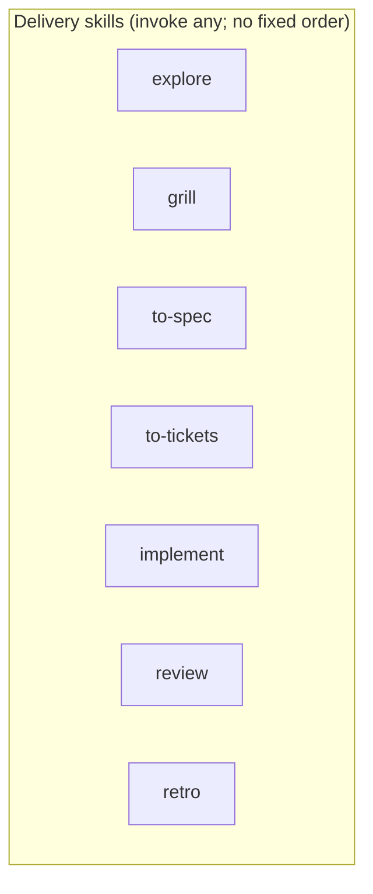

# Skill catalog

Fourteen skills in [`skills/`](../skills/). Install with `npx skills add gaboesquivel/flow-skills`. No workflow router and no mandatory sequence.

[Agent compatibility](agent-compatibility.md) · [Decision 0006](decisions/0006-flow-lite-and-flat-docs.md) · [Decision 0008](decisions/0008-leading-words-and-visual-summaries.md) · [Decision 0009](decisions/0009-adopter-product-context.md) · [Spec 002](specs/002-flow-lite-and-flat-docs.md)

Each skill has one [leading word](../GLOSSARY.md#leading-word): a compact behavior anchor already used in that skill. The words are not a second catalog and not an invocation order.

## Process

1. **Install** — Agent Skills CLI copies this repository’s `skills/` tree into the agent you choose.
2. **Work** — Build your product; use **`flow`** when root docs need alignment, or invoke any other skill explicitly.
3. **Document** — When saving artifacts, default to `docs/specs/NNN-short-name.md` and `docs/decisions/NNN-short-name.md` unless the project already uses something else.

Optional skills (every step skippable; no required order):



Product discovery, writing, and misc skills are optional and do not block delivery.

## Flow Lite

| Skill | Leading word | When to use |
| --- | --- | --- |
| [flow](../skills/flow/SKILL.md) | Preserve intent | Align the current project's root docs after meaningful changes. Not a pipeline, not initialization, and not an always-on guarantee. |

## Delivery

| Skill | Leading word | When to use |
| --- | --- | --- |
| [explore](../skills/explore/SKILL.md) | Consequential uncertainty | Understand problem, users, repo context, and uncertainty before planning or building. |
| [grill](../skills/grill/SKILL.md) | Stress-test | Stress-test an idea or plan with focused questions and evidence. |
| [to-spec](../skills/to-spec/SKILL.md) | Label unresolved assumptions | Turn conversation into a numbered spec; label assumptions; save only when requested. |
| [to-tickets](../skills/to-tickets/SKILL.md) | Vertical slice | Vertical-slice tasks with blockers; publish only when requested. |
| [implement](../skills/implement/SKILL.md) | Smallest useful increment | Implement an authorized change; no spec required for small clear work. |
| [review](../skills/review/SKILL.md) | Actionable findings | Review repo, working tree, or committed comparison. |
| [retro](../skills/retro/SKILL.md) | Improvement candidates | Retrospective on the agent environment after a session. |

## Product discovery

| Skill | Leading word | When to use |
| --- | --- | --- |
| [interview](../skills/interview/SKILL.md) | Past behavior | Plan or synthesize customer discovery interviews from what people did. |
| [jtbd](../skills/jtbd/SKILL.md) | Desired progress | Frame jobs, struggling moments, and the progress someone wants. |
| [competitors](../skills/competitors/SKILL.md) | Switching dynamics | Map alternatives, differentiation, and why people move or stay. |

## Writing

| Skill | Leading word | When to use |
| --- | --- | --- |
| [write-humans](../skills/write-humans/SKILL.md) | Lead with the point | Draft or edit clear prose for human readers. |
| [write-agents](../skills/write-agents/SKILL.md) | One authoritative home | Draft or edit agent instructions so each fact has one home. |

## Misc

| Skill | Leading word | When to use |
| --- | --- | --- |
| [tldr](../skills/tldr/SKILL.md) | Show, don't tell | Visual human summary of named material, or a session recap and alignment check. Prose stays with `write-humans`. |

## Maintain (this repository)

```bash
pnpm validate
pnpm test
```

Edit skill source under `skills/` directly. [Attribution](../ATTRIBUTION.md) and per-skill notices apply where material was adapted.
