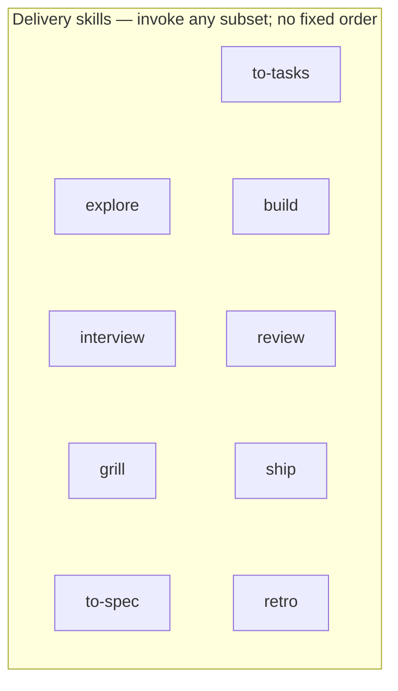

# Skill catalog

Skills live in [`skills/`](../skills/); `scripts/validate.mjs` holds the authoritative list. Install with `npx skills add gaboesquivel/flow-skills`. No mandatory sequence. Skills may name the next skill and wait; the only automatic hand-offs are `start` → `explore` and explore's `interview` and `grill` phases, each behind the user's yes, and `ship` running `build` and `review` as part of landing ([decision 0028](decisions/0028-build-and-ship.md); [decision 0024](decisions/0024-gated-hand-offs.md)).

[Agent compatibility](agent-compatibility.md) · [Decision 0006](decisions/0006-flow-lite-and-flat-docs.md) · [Decision 0009](decisions/0009-adopter-product-context.md) · [Decision 0015](decisions/0015-tasks-and-domain-modeling.md) · [Decision 0018](decisions/0018-interview-extracts-intent.md) · [Decision 0019](decisions/0019-voice-first-invocation.md) · [Spec 002](specs/002-flow-lite-and-flat-docs.md) · [Spec 008](specs/008-tasks-and-domain-modeling.md)

Talk to your agent, by typing or dictation. Each skill has a [leading word](../GLOSSARY.md#leading-word): the phrase you say to reach it. The first phrase is listed below; each skill's description carries two or three variants. The Flow block's phrase table lives in [`flow-block.mjs`](../skills/flow/lib/flow-block.mjs) (`PHRASES`), and a test checks each phrase against its skill's description. Slash commands (`/interview`, `/ship`, …) remain optional shortcuts. No skill must be named explicitly.

## Process

1. **Install** — Agent Skills CLI copies this repository’s `skills/` tree into the agent you choose.
2. **Work** — Build your product and say what you want; "update the docs" aligns root context with **`flow`**. Work needs no spec unless you want one: say "build it" for [unspecced work](../GLOSSARY.md#unspecced-work), or just ask your agent ([work without a spec](../README.md#work-without-a-spec)).
3. **Document** — When saving artifacts, default to `docs/specs/NNN-short-name.md` and `docs/decisions/NNN-short-name.md` unless the project already uses something else.

Optional skills (every step skippable; no required order):



Product discovery, writing, advisory, prototype, quality, and misc skills are optional and do not block delivery.

## Context alignment

| Skill | Say | When to use |
| --- | --- | --- |
| [flow](../skills/flow/SKILL.md) | "update the docs" | Align the current project's root docs after meaningful changes; "set up Flow here" asks only GitHub or local delivery, writes the opt-in [Flow block](../GLOSSARY.md#flow-block) into the instruction file Git tracks (adding an `@AGENTS.md` import to `CLAUDE.md` when needed, touching no adopter text outside the block and import), reports the layout, and names `explore` when the project has no goals yet ([decision 0020](decisions/0020-flow-mode.md), [decision 0030](decisions/0030-asked-delivery-and-local-mode.md), [decision 0036](decisions/0036-one-explore-depth.md)). Not a pipeline and not template initialization. |

## Delivery

| Skill | Say | When to use |
| --- | --- | --- |
| [explore](../skills/explore/SKILL.md) | "explore this" | One default depth (Skip for fixes), never asked: intent, riskiest assumption, a pre-mortem, kill criterion, main metric, journeys, alternatives, and the agent lens; deeper research only when you ask for `competitors` or `jtbd`. Asks delivery once when unset; asks its first question while background workers read what exists; extract intent, then challenge it; end in a confirmed brief, clearer intent, or a killed idea. Commits the brief on an `explore/<slug>` branch, never on the default branch. Next steps: "build it" builds the brief with no spec, or "spec it" for a tracked bet; a new product gets spec 001 and candidate stubs only on "spec it" (decisions [0036](decisions/0036-one-explore-depth.md), [0039](decisions/0039-build-never-requires-a-spec.md)). |
| [interview](../skills/interview/SKILL.md) | "interview me" | Extract what you actually want, with a guess attached to each question, before any plan or spec exists. |
| [grill](../skills/grill/SKILL.md) | "grill me" | Stress-test an idea or plan with focused questions and evidence. |
| [to-spec](../skills/to-spec/SKILL.md) | "spec it" | Turn conversation into a numbered spec with contract-first interfaces, an [Exposure](../GLOSSARY.md#exposure) line, and one required [acceptance scenario](../GLOSSARY.md#acceptance-scenario); label assumptions; write candidate stubs for later bets. Writes the spec as a `draft` file on its feature branch (renaming an `explore/` branch), and any decision beside it as **Proposed**, links them instead of showing the text, and publishes nothing. "Accept the spec" sets it to `accepted` and its linked decisions to **Accepted**; in GitHub mode it then opens the [spec issue](../GLOSSARY.md#spec-issue), labelled `accepted`, with `lib/spec-issue.mjs`; "share the draft" opens it early as `draft`. A spec without an acceptance scenario stays `draft` (decisions [0028](decisions/0028-build-and-ship.md), [0029](decisions/0029-spec-issues.md), [0032](decisions/0032-local-build-lands-ship-verifies.md), and [0035](decisions/0035-spec-issue-on-acceptance.md)). |
| [to-tasks](../skills/to-tasks/SKILL.md) | "break it down" | Vertical-slice tasks with blockers, listed as a checklist in the spec's Tasks section and, in GitHub mode, opened as sub-issues of the spec issue with blocking links; gives each task an [area](../GLOSSARY.md#area); reports the ready set and waits for "build it". |
| [build](../skills/build/SKILL.md) | "build it" | Implement an authorized change and deliver it as a pull request with green checks, with no confirmation (local mode: after the local check suite, the acceptance gate, and the one independent review, a `--no-ff` merge into local `main`, never a push). [Unspecced work](../GLOSSARY.md#unspecced-work) never needs a spec: it gets the suite and one self-check, or the independent review when the size guard escalates it; after `explore`, the brief is the request; on a repository that requires pull requests, "build it local" stops at a branch commit (decisions [0034](decisions/0034-no-ceremony-without-a-spec.md), [0039](decisions/0039-build-never-requires-a-spec.md)). On a spec's task set, runs the [frontier](../GLOSSARY.md#frontier) on one branch, each task in a worktree it creates from the spec-branch head (tasks with intersecting areas one after another), checks ancestry before integrating, runs the full local suite once per integration batch, ticks each task with its integration commit's short SHA, removes each integrated task's worktree, posts a [checkpoint](../GLOSSARY.md#checkpoint) that never waits, opens one pull request per spec, and waits for CI only on that final pull request ([decision 0029](decisions/0029-spec-issues.md)); [shared files](../GLOSSARY.md#shared-file) never move the reviewed head ([decision 0033](decisions/0033-shared-files-and-reviewed-head.md)); owns the [delivery mode](../skills/build/SKILL.md#delivery-mode), asked once when unset (decisions [0028](decisions/0028-build-and-ship.md), [0030](decisions/0030-asked-delivery-and-local-mode.md), and [0032](decisions/0032-local-build-lands-ship-verifies.md)). |
| [review](../skills/review/SKILL.md) | "check it against the spec" | Review against intent and root context on five axes: correctness, readability, architecture, security, performance; one worker per axis, then a verifier that dedupes and ranks; a spec review also gives each requirement a [verdict](../GLOSSARY.md#requirement-verdict) (satisfied, unmet, unresolved) with evidence. Workers read the reviewed commit with `git show` or a detached worktree of their own, never checking out in someone else's checkout. |
| [ship](../skills/ship/SKILL.md) | "ship it" | Land accepted work, or [unspecced work](../GLOSSARY.md#unspecced-work), with no confirmation: build if needed, run the one independent review of the spec (one worker per axis plus a verifier) and post it on the pull request, fix findings, wait for green checks, merge, delete the branch, prune the spec's task worktrees, and sync the local default branch. Local mode pushes the `main` that `build` reviewed and merged, when a remote exists. When the host or protection refuses the merge, stops with a ready-to-merge report and never retries. Then [verifies](../GLOSSARY.md#verification) the shipped commit: finds its GitHub deployment and runs the spec's acceptance scenario on it with screenshots (GitHub mode also on the preview before merge); with no deployment, runs locally and reports "deployment unverified"; a failure after landing is "shipped, verification failed", never rolled back unless asked. Spec work needs an accepted spec (in GitHub mode, the `accepted` label on its issue); unspecced work gets the independent review here only when `build`'s size guard escalated it; "drop the spec" closes an abandoned spec's issues as not planned (decisions [0028](decisions/0028-build-and-ship.md), [0029](decisions/0029-spec-issues.md), [0030](decisions/0030-asked-delivery-and-local-mode.md), [0032](decisions/0032-local-build-lands-ship-verifies.md), [0033](decisions/0033-shared-files-and-reviewed-head.md), [0034](decisions/0034-no-ceremony-without-a-spec.md), and [0039](decisions/0039-build-never-requires-a-spec.md)). |
| [retro](../skills/retro/SKILL.md) | "let's do a retro" | Retrospective on the agent environment after a session. |

## Shared language

| Skill | Say | When to use |
| --- | --- | --- |
| [domain-modeling](../skills/domain-modeling/SKILL.md) | "what do we call this" | Refine terminology and update `GLOSSARY.md`; offer `docs/decisions/` records sparingly. |

## Advisory

| Skill | Say | When to use |
| --- | --- | --- |
| [council](../skills/council/SKILL.md) | "ask the council" | Independent perspectives on a consequential decision. It does not implement or approve. |

## Prototype

| Skill | Say | When to use |
| --- | --- | --- |
| [prototype](../skills/prototype/SKILL.md) | "prototype this" | Build a throwaway experiment for a design, interaction, API, or logic question. |

## Quality

| Skill | Say | When to use |
| --- | --- | --- |
| [debug](../skills/debug/SKILL.md) | "debug this" | Investigate a reproducible failure from evidence before changing code. |

Code simplification, security audits, and performance work belong to host tools ([0019](decisions/0019-voice-first-invocation.md)).

## Product discovery

| Skill | Say | When to use |
| --- | --- | --- |
| [jtbd](../skills/jtbd/SKILL.md) | "jobs to be done" | Frame jobs, struggling moments, and the progress someone wants. |
| [competitors](../skills/competitors/SKILL.md) | "who are the competitors" | Map alternatives, differentiation, and why people move or stay. |

## Writing

| Skill | Say | When to use |
| --- | --- | --- |
| [write-humans](../skills/write-humans/SKILL.md) | "write this up" | Draft or edit clear prose for human readers. |
| [write-agents](../skills/write-agents/SKILL.md) | "write agent instructions" | Draft or edit agent instructions so each fact has one home. |

## Project start

| Skill | Say | When to use |
| --- | --- | --- |
| [start](../skills/start/SKILL.md) | "start a Next.js project" | Confirm template, name, destination, and delivery (local when no GitHub repository is created), then initialize from flow-next or flow-mono (rename identity, setup/QA/build/startup checks, baseline root docs, the Flow block in the tracked instruction file with any `@AGENTS.md` import, one independent initial commit holding both when verification passes) while `explore` shapes the product. "Set up Flow here" plus a template bootstrap. |

## Misc

| Skill | Say | When to use |
| --- | --- | --- |
| [tldr](../skills/tldr/SKILL.md) | "tldr" | Visual human summary of named material, or a session recap and alignment check. Prose stays with `write-humans`. |
| [board](../skills/board/SKILL.md) | "show the board" | Read-only kanban of specs by stage (Candidate, Specced, Ready, Building, Shipped), derived from git. Opens a live local page, or a static snapshot with `--once`. |
| [handoff](../skills/handoff/SKILL.md) | "hand off" | Compact the current conversation into a temporary handoff document so a fresh agent can continue. |

## Maintain (this repository)

```bash
pnpm validate
pnpm test
```

Edit skill source under `skills/` directly. [Attribution](../ATTRIBUTION.md) and per-skill notices apply where material was adapted.
