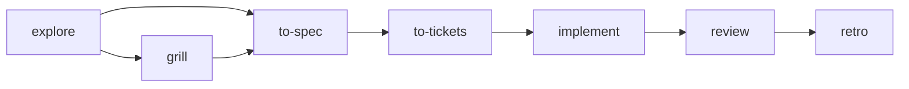

# Skill catalog

Thirteen manually invoked skills in [`skills/`](../skills/). Install with `npx skills add gaboesquivel/flow-skills`. No router skill and no mandatory sequence.

[Agent compatibility](agent-compatibility.md) · [Decision 0004](decisions/0004-portable-skill-catalog.md) · [Spec 001](specs/001-portable-skill-catalog.md)

## Process

1. **Install** — Agent Skills CLI copies this repository’s `skills/` tree into the agent you choose.
2. **Invoke** — Run one skill explicitly (`/to-spec`, skill picker, or equivalent).
3. **Document** — When saving artifacts, default to `docs/specs/NNN-short-name.md` and `docs/decisions/NNN-short-name.md` unless the project already uses something else.

Optional delivery flow (every step skippable):



Product discovery skills are optional and do not block delivery skills.

## Delivery

| Skill | When to use |
| --- | --- |
| [explore](../skills/explore/SKILL.md) | Understand problem, users, repo context, and uncertainty before planning or building. |
| [grill](../skills/grill/SKILL.md) | Stress-test an idea or plan with focused questions and evidence. |
| [to-spec](../skills/to-spec/SKILL.md) | Turn conversation into a numbered spec; save only when requested. |
| [to-tickets](../skills/to-tickets/SKILL.md) | Vertical-slice tasks with blockers; publish only when requested. |
| [implement](../skills/implement/SKILL.md) | Implement an authorized change; no spec required for small clear work. |
| [review](../skills/review/SKILL.md) | Review repo, working tree, or committed comparison. |
| [retro](../skills/retro/SKILL.md) | Retrospective on the agent environment after a session. |

## Product discovery

| Skill | When to use |
| --- | --- |
| [interview](../skills/interview/SKILL.md) | Plan or synthesize customer discovery interviews. |
| [jtbd](../skills/jtbd/SKILL.md) | Frame jobs, struggling moments, and desired progress. |
| [competitors](../skills/competitors/SKILL.md) | Map alternatives, differentiation, and switching dynamics. |

## Writing

| Skill | When to use |
| --- | --- |
| [write-humans](../skills/write-humans/SKILL.md) | Draft or edit clear writing for human readers. |
| [write-agents](../skills/write-agents/SKILL.md) | Draft or edit agent instructions and navigable context. |

## Misc

Session utilities that do not replace delivery or writing skills.

| Skill | When to use |
| --- | --- |
| [tldr](../skills/tldr/SKILL.md) | Visual recap of the conversation and a quick user–agent alignment check. |

## Maintain (this repository)

```bash
pnpm validate
pnpm test
```

Edit skill source under `skills/` directly. [Attribution](../ATTRIBUTION.md) and per-skill notices apply where material was adapted.
