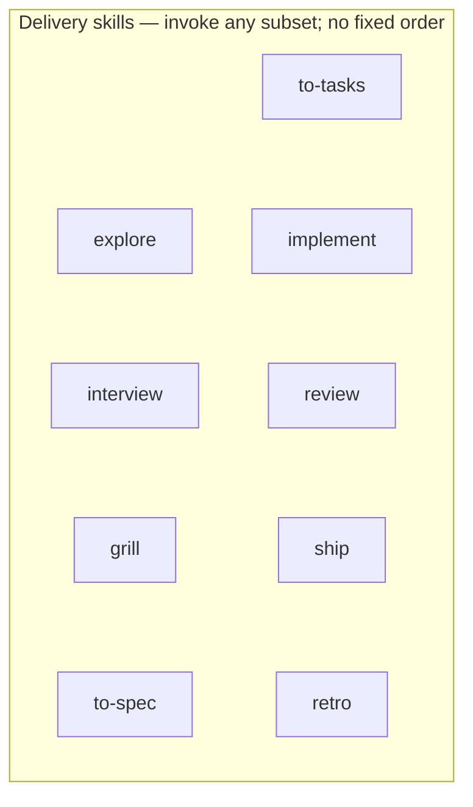

# Skill catalog

Skills live in [`skills/`](../skills/); `scripts/validate.mjs` holds the authoritative list. Install with `npx skills add gaboesquivel/flow-skills`. No workflow router and no mandatory sequence.

[Agent compatibility](agent-compatibility.md) · [Decision 0006](decisions/0006-flow-lite-and-flat-docs.md) · [Decision 0009](decisions/0009-adopter-product-context.md) · [Decision 0015](decisions/0015-tasks-and-domain-modeling.md) · [Decision 0018](decisions/0018-interview-extracts-intent.md) · [Decision 0019](decisions/0019-voice-first-invocation.md) · [Spec 002](specs/002-flow-lite-and-flat-docs.md) · [Spec 008](specs/008-tasks-and-domain-modeling.md)

Talk to your agent, by typing or dictation. Each skill has a [leading word](../GLOSSARY.md#leading-word): the phrase you say to reach it. The first phrase is listed below; each skill's description carries two or three variants. Slash commands (`/interview`, `/ship`, …) remain optional shortcuts. Only `start` must be named explicitly.

## Process

1. **Install** — Agent Skills CLI copies this repository’s `skills/` tree into the agent you choose.
2. **Work** — Build your product and say what you want; "update the docs" aligns root context with **`flow`**.
3. **Document** — When saving artifacts, default to `docs/specs/NNN-short-name.md` and `docs/decisions/NNN-short-name.md` unless the project already uses something else.

Optional skills (every step skippable; no required order):



Product discovery, writing, advisory, prototype, quality, and misc skills are optional and do not block delivery.

## Flow Lite

| Skill | Say | When to use |
| --- | --- | --- |
| [flow](../skills/flow/SKILL.md) | "update the docs" | Align the current project's root docs after meaningful changes; "set up Flow here" writes the opt-in Flow block ([decision 0020](decisions/0020-flow-mode.md)). Not a pipeline and not initialization. |

## Delivery

| Skill | Say | When to use |
| --- | --- | --- |
| [explore](../skills/explore/SKILL.md) | "explore this" | Propose a depth (Skip, Lite, Full); extract intent, then challenge it; end in a confirmed brief, clearer intent, or a killed idea. |
| [interview](../skills/interview/SKILL.md) | "interview me" | Extract what you actually want, with a guess attached to each question, before any plan or spec exists. |
| [grill](../skills/grill/SKILL.md) | "grill me" | Stress-test an idea or plan with focused questions and evidence. |
| [to-spec](../skills/to-spec/SKILL.md) | "spec it" | Turn conversation into a numbered spec; label assumptions; save only when requested. |
| [to-tasks](../skills/to-tasks/SKILL.md) | "break it down" | Vertical-slice tasks with blockers, recorded as GitHub issues (pull-request mode) or in the spec's Tasks section (local mode); reports the ready set and waits for "ship it". |
| [implement](../skills/implement/SKILL.md) | "build it" | Implement an authorized change; no spec required for small clear work. |
| [review](../skills/review/SKILL.md) | "check it against the spec" | Review against intent and root context on five axes: correctness, readability, architecture, security, performance. |
| [ship](../skills/ship/SKILL.md) | "ship it" | Verify, commit, confirm, push, and check the deployment this repo configures, deferring to the platform's deploy skill. On a spec's task set, orchestrates every task on one branch and finishes by [delivery mode](../GLOSSARY.md#delivery-mode). |
| [retro](../skills/retro/SKILL.md) | "let's do a retro" | Retrospective on the agent environment after a session. |

## Shared language

| Skill | Say | When to use |
| --- | --- | --- |
| [domain-modeling](../skills/domain-modeling/SKILL.md) | "what do we call this" | Refine terminology and update `GLOSSARY.md`; offer `docs/decisions/` records sparingly. |

## Advisory

| Skill | Say | When to use |
| --- | --- | --- |
| [council](../skills/council/SKILL.md) | "ask the council" | Independent perspectives on a consequential decision. It does not implement or approve. |

## Prototype

| Skill | Say | When to use |
| --- | --- | --- |
| [prototype](../skills/prototype/SKILL.md) | "prototype this" | Build a throwaway experiment for a design, interaction, API, or logic question. |

## Quality

| Skill | Say | When to use |
| --- | --- | --- |
| [debug](../skills/debug/SKILL.md) | "debug this" | Investigate a reproducible failure from evidence before changing code. |

Code simplification, security audits, and performance work belong to host tools ([0019](decisions/0019-voice-first-invocation.md)).

## Product discovery

| Skill | Say | When to use |
| --- | --- | --- |
| [jtbd](../skills/jtbd/SKILL.md) | "jobs to be done" | Frame jobs, struggling moments, and the progress someone wants. |
| [competitors](../skills/competitors/SKILL.md) | "who are the competitors" | Map alternatives, differentiation, and why people move or stay. |

## Writing

| Skill | Say | When to use |
| --- | --- | --- |
| [write-humans](../skills/write-humans/SKILL.md) | "write this up" | Draft or edit clear prose for human readers. |
| [write-agents](../skills/write-agents/SKILL.md) | "write agent instructions" | Draft or edit agent instructions so each fact has one home. |

## Project start

| Skill | Say | When to use |
| --- | --- | --- |
| [start](../skills/start/SKILL.md) | `/start` (explicit only) | Initialize from flow-next or flow-mono: rename identity, run setup/QA/build/startup checks, baseline root docs, and one independent initial commit when verification passes. Not Flow Lite. |

## Misc

| Skill | Say | When to use |
| --- | --- | --- |
| [tldr](../skills/tldr/SKILL.md) | "tldr" | Visual human summary of named material, or a session recap and alignment check. Prose stays with `write-humans`. |
| [handoff](../skills/handoff/SKILL.md) | "hand off" | Compact the current conversation into a temporary handoff document so a fresh agent can continue. |

## Maintain (this repository)

```bash
pnpm validate
pnpm test
```

Edit skill source under `skills/` directly. [Attribution](../ATTRIBUTION.md) and per-skill notices apply where material was adapted.
