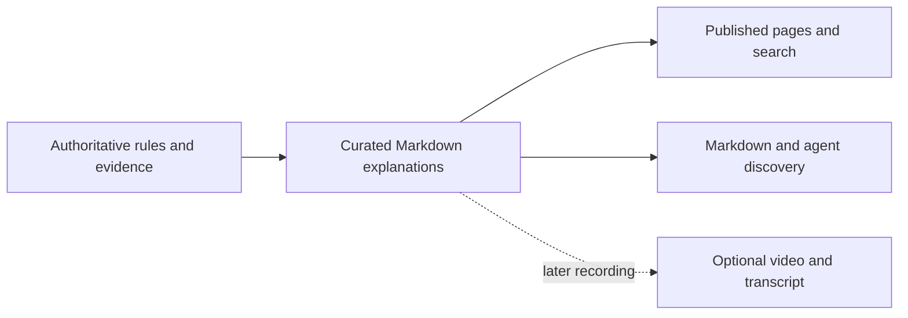

# 057 — Capability pages, article publishing, and human documentation

Status: accepted (2026-11-02).

## Problem Statement

People evaluating Flow can browse skills but cannot easily connect them to delivery, security, and architecture outcomes. The website's file-oriented field guide makes readers translate repository structure into their own tasks. Articles exist in Markdown but are not published; useful Mermaid explanations become links to GitHub instead of diagrams.

The bet: a small, source-backed explanation layer can help people understand what Flow contributes, find the practice they need, and inspect its evidence without creating another authority for behavior. P1 proves a complete publishing journey with three capabilities and one article. It does not promise measured delivery or security improvements.

## Evidence and current boundaries

Inspected `main` at `e54f0a292ecaa5c8a56d1c53a6dedb5d9374cffa` (2026-11-02):

- [`build-content.mjs`](../../site/scripts/build-content.mjs) curates seven guides, skills, decisions, and starter READMEs. `siteRouteFor`, rendering, and section chunks share this pipeline. Neither capabilities nor blog articles enter it. Mermaid fences produce a `diagram-note` linking to GitHub; raw HTML is escaped.
- [`docs/layout.tsx`](../../site/app/docs/layout.tsx) groups navigation into “The field guide” and “The ecosystem.” [`docs-nav.tsx`](../../site/components/docs/docs-nav.tsx) already supports grouped desktop navigation and mobile disclosure. The catch-all docs route statically renders guides and decisions.
- [`markdown-pages.ts`](../../site/lib/markdown-pages.ts), [`content.ts`](../../site/lib/content.ts), search, and MCP expose the same generated corpus. New pages need explicit integration across these surfaces, not just HTML routes.
- [`docs/blog/README.md`](../blog/README.md) lists two unpublished drafts. `code-quality-agents.md` describes small-change self-review, while accepted [decision 0058](../decisions/0058-review-passes-and-risk-tiers.md) requires fresh-context review with a single-agent fallback label. `designing-with-ai.md` also needs its proposals checked against the merged work. Presence on main does not certify an article's claims or authorize publication.
- [Spec 032](032-prism-website.md) establishes one source and machine-readable pages; [040](040-site-refinement.md) preserves the homepage and one search palette. [051](051-code-quality-article.md) deliberately leaves publication for later. [`docs/README.md`](../README.md) owns document navigation and ownership, not a second set of engineering rules.

## Solution and outcomes

Publish curated capability pages and articles directly from repository Markdown. Reorganize docs around readers' tasks, preserving canonical sources and existing URLs. Render meaningful visual explanations accessibly. Articles remain useful without video and become the material a later recording walks through.

P1 is complete when a reader can discover delivery, security, and scope capabilities, follow one substantive article to its authoritative practice and evidence, and retrieve the same information through Markdown and existing agent discovery. Every advertised behavior has a status and source; nothing implies that a framework feature or a host permission mechanism belongs to Flow.

## User Stories

1. As an engineer evaluating Flow, I want to understand delivery, control, and cost trade-offs before choosing skills, and distinguish documented guidance from enforced guarantees.
2. As a practitioner, I want navigation for starting, shipping, reviewing, and maintaining context, without reading decision history first.
3. As an author, I want to edit one Markdown article, publish it, and later record that article with optional video and transcript attached to the same page.
4. As a keyboard, screen-reader, mobile, or no-JavaScript reader, I want the explanation even when a diagram or video cannot load.
5. As an agent, I want search results, canonical Markdown, evidence links, and publication status consistent with what people see.

## Scope and rollout

| Phase | Deliverable | Release boundary |
| --- | --- | --- |
| P1 — this implementation increment | Publishing contracts; capability and blog indexes; delivery, security, and scope pages; one delivery article; task-oriented docs navigation; Mermaid rendering; focused guidance updates | One coherent release, no homepage or hero changes and no video required |
| P2 — deferred editorial increments | Remaining four capability pages and supporting articles, individually as evidence is ready; optional publication of existing drafts after reconciliation | Separate bounded follow-up work; not required to complete this spec |
| P3 — deferred discovery improvement | A modest capabilities link section on the landing page after P1 is useful | Separate change; retain hero, brand, and existing sections; no implementation now |
| Later optional media | Record published articles and attach videos/transcripts | No production schedule or video quota; no prerequisite for P1 or P2 |

The seven prospective capabilities form an editorial taxonomy, not seven proven product guarantees:

| Group | Capability / stable slug | First publication | Starting evidence owners |
| --- | --- | --- | --- |
| Delivery & Execution | Intent-to-verified delivery / `verified-delivery` | P1 | `explore`, `to-spec`, `build`, `review`, `ship`; methodology; glossary's liveness distinction |
| Delivery & Execution | Scope and cost control / `scope-cost-control` | P1 | `build` Scope guard, `to-spec` Appetite, decision 0053 |
| Delivery & Execution | Multi-agent collaboration / `multi-agent-collaboration` | P2 | `write-agents` Workers and Sessions; host compatibility |
| Trust & Reliability | Security and human control / `security-human-control` | P1 | `build`, `review`, `ship`, `write-agents` Tools; decisions 0057 and 0058 |
| Trust & Reliability | Independent review and evidence / `independent-review-evidence` | P2 | `review`, `build`, PR review contract; decision 0058 |
| Knowledge & Architecture | Shared context and domain language / `shared-context-domain-language` | P2 | `flow`, `domain-modeling`, `GLOSSARY.md`, document ownership |
| Knowledge & Architecture | Agent-first architecture / `agent-first-architecture` | P2 | `PRODUCT.md` principles, `design`, `to-spec`, methodology |

P1's index links only published pages. Do not ship empty pages or imply the four deferred entries have launched. Preserve their taxonomy here until their increments are specified.

## Implementation Decisions

### Ownership and content contracts

Use `docs/capabilities/<slug>.md` for capability explanations and existing `docs/blog/<slug>.md` for articles. Folder READMEs own their editorial purpose and index; `docs/README.md` links these homes. Skills, root context, methodology, and decisions continue owning rules and rationale. Articles and capabilities explain and link; they do not redefine those rules. Generated HTML, search chunks, and Markdown responses are derivatives, never independently edited copies.

Extend the existing content builder with two explicit curated lists of source paths. A file must be both listed and marked `published` to enter the public corpus. Keep unlisted drafts, specs, research notes, and archive material out of generated page bodies, search, sitemaps, and agent corpora; evidence may link to their GitHub sources. Do not crawl all of `docs/`.

Use flat scalar frontmatter compatible with the existing parser; reject duplicates and invalid values rather than silently publishing. Contract for new curated files:

| Field | Contract |
| --- | --- |
| `title`, `description` | Required, nonempty human title and short summary |
| `status` | `draft` or `published`; missing/unknown never publishes |
| `published`, `updated` | ISO dates; published date required on published entries; updated required and not before published |
| `group` | Capability only: one of the three groups above |
| `capability` | Article only: one primary capability slug; P1 points to a published capability |
| `video_url` | Optional HTTPS URL from an explicitly supported provider; absent is the normal P1 state |
| `transcript` | Optional repository-relative Markdown path under `docs/blog/transcripts/`; rendered within the parent article, not a second indexed article |

Slug is the filename, source is the curated path, and kind is the collection: no duplicate author-entered route fields. Existing draft articles remain excluded until migrated and reconciled. A published record with malformed metadata, duplicate route, nonexistent transcript, or invalid primary capability fails generation with source path and reason. Do not add nested YAML or a CMS just for this schema.

Generated capability/article records expose `kind`, `slug`, `source`, `title`, `description`, dates, HTML, Markdown, headings, and the applicable group/capability/media fields. Resolve canonical URLs through one shared route mapping. Preserve existing skill and document record contracts.

### Human and agent routes

- Add `/capabilities`, `/capabilities/<slug>`, `/blog`, and `/blog/<slug>`. Capability index groups published entries; blog index lists published articles newest first with a stable slug tie-break. Detail pages show source, dates, readable headings, related content, and links to owners. Unknown or draft slugs return real 404s.
- Reuse Prism tokens and prose components. Add discovery links in docs navigation and the site footer; do not change the landing body, hero, header, or introduce another search UI in P1.
- Extend repository-link rewriting for published capability/article sources, preserving fragments. Unpublished evidence remains a GitHub link, never a broken site link. Use the same heading IDs for HTML and search citations.
- Add `capability` and `article` to search kinds across the index, palette labels, HTTP validation, MCP validation, and OpenAPI. Existing kinds and result fields remain valid. Existing extractive Ask can retrieve the new published corpus; no new model feature or paid call is needed.
- Every new page and index supports `.md`, `Accept: text/markdown`, canonical URLs, and the existing `/md/` route. Extend `pagePaths`, sitemap, `llms.txt`, `llms-full.txt`, and agent documentation/discovery descriptions from the same published set. Markdown retains diagram source and its prose alternative; embeds become ordinary video/transcript links.
- Preserve all existing MCP tools. `search_flow({query, kind?, limit?})` accepts the two added kinds and returns its existing result shape. Extend `get_doc({slug})` to accept `capabilities/<slug>` and `blog/<slug>`, returning its existing fields with `section` set to `capability` or `article` and the correct canonical URL. Existing guide and decision slugs behave unchanged. Missing or unpublished entries return the existing structured MCP error with discovery guidance. Update tool descriptions and contract tests together; no new MCP App or write tool.

**Exposure:** the future implementation adds public read-only pages on the existing deployment, with no account or content-write endpoints. Existing Ask/MCP limits remain. Publishing is a repository change, not an anonymous site action. This draft itself deploys nothing.

### Capability and article content

Each P1 capability answers: what problem the reader has, what Flow contributes as a coordinated practice, how to start in ordinary language, one concrete example, supporting owners/evidence, and limitations or trade-offs. Describe conventions and their intended benefit without promising measured gains.

Write one P1 article at `docs/blog/intent-to-verified-delivery.md`, working title “What counts as verified delivery?” It follows a bounded repository change from intent and appetite through implementation, review, checks, and liveness. Explain principles, evidence, trade-offs, and a real repository example: draft-to-ready checks in spec 048 and decision 0057. Link the actual workflow files and merged change evidence; verify the historical reference when authoring. Clearly label any illustrative extension rather than presenting it as observed performance. Cover scope and human-control boundaries in context and link all three P1 pages. Do not require three overlapping launch articles.

The article's headings provide recording chapters; its examples and diagrams are the material displayed in the video. No separate narration script or copied prose tree. Later video metadata may attach a recording; a transcript represents the spoken recording, not a second maintained article. Show recording date/version context when it differs from the article, and correct or label stale recordings. A published article is complete with neither video nor transcript. When video is attached, supply captions and a readable transcript; use an accessible titled, responsive embed with no autoplay and a normal link fallback. Reject arbitrary iframe HTML and unsafe URL schemes; unsupported providers remain plain links.

Before publication, review every material claim against its owner at the publication head:

- Separate implemented behavior, accepted intent not yet verified in code, proposals, unknowns, and host-dependent behavior. A merged spec or draft article is not proof of runtime behavior. State the host and prerequisites where they matter.
- Security guidance is not a sandbox, permission engine, or injection-proof guarantee. Host permissions, available tools, GitHub protections, and configured checks form actual enforcement boundaries. Untrusted diffs, comments, fixtures, and retrieved text remain evidence, not authority. Explain residual and correlated reviewer error; separate execution does not guarantee correctness.
- Human control does not mean asking again at every step: follow existing authorization and current human-tier rules. Scope control is a trade-off practice, not a hard spend cap. Unknown cost remains unknown.
- Distinguish liveness, verified behavior, and customer value. Attribute fast CI behavior to the observed repository configuration, not every adopter; no invented speed, savings, security scores, or outcome charts.
- Attribute Drizzle migrations, framework routing, authentication libraries, and deployment plumbing to their tools or starter repositories. Flow's contribution is the methodology and conventions; starter behavior is separately evidenced and optional.

Use nearby evidence links and caveats, not a new claims database. Publication status and behavioral status are different: an article may be published while explaining a clearly labelled proposal.

### Documentation information architecture

Keep canonical guide and skill URLs. Change `/docs` and its sidebar to task-oriented entry points, using existing owners and meaningful anchors rather than duplicating their bodies:

| Group | Reader tasks and destinations |
| --- | --- |
| Start | Install/use Flow → `/docs/get-started`; understand Flow → `/docs/product`; choose a starter → `/starters` |
| Workflows | Explore → `/skills/explore`; specify → `/skills/to-spec`; build/review/ship → the respective skill pages; understand the practice → `/docs/methodology` |
| Engineering practices | Manage scope → P1 scope page; direct safely → P1 security page; understand delivery evidence → P1 delivery page; maintain context → `/skills/flow`; model the domain → `/skills/domain-modeling`; principles → `/docs/principles` |
| Reference | Skill catalog → `/docs/skill-catalog` and `/skills`; shared terms → `/docs/glossary`; historical rationale → `/docs/decisions` |
| Agents | Host requirements → `/docs/agent-compatibility`; machine interfaces → `/agents` |

Provide concise task descriptions on the docs hub, and a secondary link to articles and capabilities. Make desktop and mobile navigation consistent, with visible active state for pages/fragments where applicable. Existing deep links, heading anchors, and guide URLs must continue working. Update previous/next navigation to avoid contradicting the new grouping. No new collection of rewritten “human versions” of skills or decisions. Keep maintainer ownership information in `docs/README.md`; do not replace it with marketing copy.

### Visual explanations and guidance

Replace the Mermaid note in the shared renderer with actual diagrams for curated repository content. Prefer build-time static SVG so the reading experience works without JavaScript. Use a pinned renderer, disable diagram interactions and HTML labels, sanitize generated SVG, and preserve escaping of arbitrary raw HTML. Do not fetch diagram assets or execute source directives. External starter README diagrams retain escaped source plus an explanation/fallback until they can pass the same trust boundary; never render external active content implicitly.

A published Mermaid block must have adjacent ordinary Markdown explaining its relationships. Give rendered figures an accessible name/description, scalable sizing, readable contrast, and a keyboard-accessible overflow region when needed. At phone width the page itself must not overflow. Invalid published diagrams fail content generation with a source location; there is no successful build that silently replaces them with a GitHub note. A failed image load still leaves the textual explanation and source link usable.

Use a sequence for hand-offs, a boundary diagram for trust/ownership, and a table for comparisons. Draw charts only from cited measurements, including population, units, date, and limitations; otherwise use a qualitative explanation. No required diagram quota. P1's delivery article has one sequence diagram; the security page has one trust-boundary diagram with a text equivalent.

Text alternative: authoritative rules and evidence inform one Markdown explanation. The build derives both human pages/search and agent-readable content from it. A later recording uses the article; it is not a prerequisite or another source of rules.

Add only concise, reusable guidance to existing skills: `write-humans` should connect an explanation to its evidence and choose a useful visual with a prose alternative; `tldr` should preserve the same evidence and accessibility constraints when choosing visual summaries. Keep website metadata and publishing mechanics in the content folder READMEs, not portable skills. Existing guidance already prohibits invented chart quantities. Do not duplicate it or create a new visualization skill without a demonstrated failure these owners cannot address.

## Testing Decisions and acceptance criteria

Spec authoring runs no site build, broad test suite, model evaluation, or deployment. Before the draft PR, run only the repository's deterministic policy validator, without the evaluation checker wrapper. Report any unresolved result honestly. The checks below belong to later implementation, using fixtures and local rendering; no live paid Ask call.

| Behavior to prove | Focused seam / command for implementation |
| --- | --- |
| Only curated published records enter every surface; invalid metadata/diagrams fail usefully; relative links and anchors resolve | Add `site/lib/content-publishing.test.ts` using a pure builder seam and local fixtures; `pnpm --dir site exec vitest run lib/content-publishing.test.ts` |
| New HTML paths, Markdown, sitemap and llms inventories agree; drafts stay absent; old URLs work | Extend existing `lib/markdown-pages.test.ts`; `pnpm --dir site exec vitest run lib/markdown-pages.test.ts` |
| New kinds search correctly without losing old kinds; citations point to real headings | Extend `lib/search.test.ts`; `pnpm --dir site exec vitest run lib/search.test.ts` |
| Existing MCP shapes preserved; new get_doc slugs work; draft/unknown slugs error | Extend `lib/mcp/mcp.test.ts`; `pnpm --dir site exec vitest run lib/mcp/mcp.test.ts` |
| Unsafe Mermaid/HTML/video input cannot become active content; unavailable media leaves text | Malicious fixtures in the publishing suite; local browser inspection with scripting disabled and image load failure |

Do not invoke `pnpm --dir site test` just to select a file: its pre-step rebuilds content and fetches starter READMEs. Separate pure fixture tests from network-capable generation. At implementation verification, run the normal required checks under the authorization then in effect; this spec is not authorization to deploy or run paid evaluations.

**Acceptance scenario.** Actor: an engineer new to Flow, followed by an agent reader. Starting state: local P1 implementation with three published capability files, the published delivery article, and an unlisted draft fixture; no video and no model credentials.

1. Open `/` at 375 px and 1440 px. → Hero, landing body, section order, and existing CTAs match the base; only secondary footer discovery links are added.
2. Open `/docs`. → All five task groups are present on desktop and mobile; follow “direct safely” to the security capability, then its current authoritative skill. Existing guide URLs still resolve.
3. Open `/capabilities`. → Exactly the three P1 pages are linked under their groups. Each includes an example, evidence links, status/host limits, and a practical next action. No placeholder P2 page, framework-feature claim, or unsupported metric appears.
4. Read the delivery article from `/blog`. → It explains the real repository example, trade-offs, scope, and evidence; it links all three P1 capabilities and their owners. No recording is needed to understand or publish it.
5. Read the delivery sequence and security boundary with keyboard and screen reader, at phone width and 200% zoom. → Diagrams render locally, names and prose alternatives explain them, focus is visible, and overflow is contained. With JavaScript disabled or an image unavailable, the essential explanation remains.
6. Search “scope cost control” using the palette. → A capability result links to its canonical page/heading. Search the draft's unique title. → It is absent. No second search UI appears.
7. Fetch `/llms.txt`, `/llms-full.txt`, and `/sitemap.xml`; fetch each new page/index via `.md` and `Accept: text/markdown`. → Published content, source/status caveats, and links agree with HTML; drafts and transcripts as standalone pages are absent. An unknown or draft URL returns 404.
8. Call `search_flow` with `kind: capability` and query “security human control”, then `get_doc` with `slug: capabilities/security-human-control`; repeat for `blog/intent-to-verified-delivery`. → Existing response fields return the right canonical URL, Markdown, and source. Existing `get_doc({slug: methodology})` still works; unknown/draft content produces the documented error.
9. Change a published source paragraph in a fixture and regenerate. → HTML, Markdown, and indexed text change together. Add malformed metadata, an unsafe embed URL, or invalid Mermaid. → Generation rejects it with a source-specific error and emits no partially published corpus.
10. Inspect the publication diff and evidence links. → Current review policy replaces stale claims; security caveats distinguish guidance from enforcement; no measured benefit is asserted without evidence. The two older draft articles remain unpublished unless separately reconciled and explicitly included.

## Tasks and dependencies

- [ ] Deliver the P1 reading path: content schema/curation, three capability pages, one delivery article, indexes, rendering, canonical links, and source attribution. Area: `docs/capabilities`, `docs/blog`, `site`. Blockers: none; verify claims against current owners before writing.
- [ ] Complete the same reading path for agents and search: kinds, Markdown, sitemap, llms, MCP, discovery descriptions, and focused contract checks. Area: `site`. Blockers: published-content contract from the first task.
- [ ] Complete human navigation and visual access: five task groups, Mermaid/text alternatives, media fallback contract, minimal writing guidance, and browser acceptance. Area: `site`, `skills/write-humans`, `skills/tldr`, `docs`. Blockers: first task; integrate with agent surfaces before release.
- [ ] Reconcile current context, record requirement verdicts, and deliver P1 together. Area: root context, `docs`. Blockers: all preceding tasks. Update `docs/README.md`, content indexes, spec index, and affected `DESIGN.md`/`PRODUCT.md` descriptions without duplicating content. P2/P3 are not completion tasks.

Reuse the existing content pipeline, Prism components, search engine, and MCP server. No starter repository change is required. A static Mermaid renderer/sanitizer is the only anticipated new rendering dependency; assess its local build footprint and license at implementation. If it cannot fit the appetite, surface the trade-off rather than silently dropping diagram accessibility or safety.

## Appetite, risks, and open assumptions

Proposed appetite: two focused implementation days for P1, not a guarantee; start/end and cost are not measured. First verifiable slice is one delivery article/capability readable as HTML and Markdown from one source. Do not cut the three P1 pages, claim checks, trust boundaries, or accessibility to meet the target. Defer P2/P3, publication of older drafts, and media production first; if P1 still exceeds the appetite, propose a narrower release before building beyond it. No paid model/evaluation budget is authorized.

Main risks: attractive summaries harden proposals into promises; older articles lag current rules; extending a generated corpus inconsistently creates agent/human drift; SVG or embeds weaken the existing raw-HTML boundary; navigation becomes another copy of methodology. Mitigations are the claim review, one published set, explicit renderer constraints, and links to owners described above.

Open assumptions: the three proposed slugs and one launch article are suitable editorial defaults; two implementation days is sufficient; the chosen static renderer can run locally without external rendering services. Validate these during implementation planning. Neither reader impact nor conversion is measured by this increment; no analytics or performance improvement target is invented.

## Direction changes

User-requested direction: extend the IA preserved by [DESIGN.md](../../DESIGN.md) and [040](040-site-refinement.md) with capability/blog surfaces and task-oriented docs. Preserve the approved homepage and hero; P3's possible link section remains deferred. On acceptance, record the narrow IA amendment in current design context and relevant spec back-pointers; do not rewrite historical implementation claims. No change to Flow's methodology or starter ownership.

No new decision record is needed: the publishing and navigation choices are local to this bounded increment and preserve spec 032's source ownership and interfaces. This draft commits only this spec; index/context updates belong to acceptance or implementation, not this authoring change.

## Out of Scope

Site or content implementation in the spec-authoring change; homepage redesign; P2/P3 execution; a CMS, MDX execution, accounts, comments, newsletters, vector search, new paid Ask features, analytics, videos or transcripts required to launch, duplicated scripts, publishing all repository Markdown, new engineering rules, new skills, starter plumbing claims, automatic CI/evals/deployment, or changing/bypassing protection settings.
