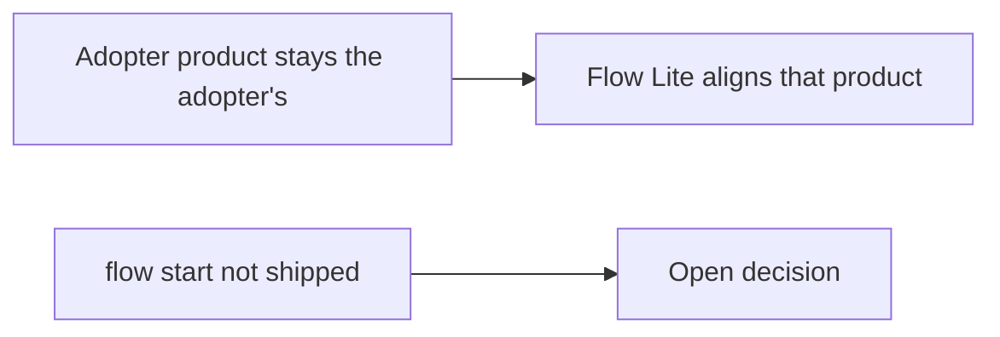

# Dogfood: product context and a pricing review (2026-10-27)

Host: Cursor. One agent. This is not a second agent product.

## Task

Keep Flow's methodology identity in this repository's `PRODUCT.md`. Stop Flow Lite from copying that identity into another project. Review a small checkout discount defect, including an untracked fix, without a spec or a new skill.

## Skills actually followed

- **explore** — read `PRODUCT.md`, `AGENTS.md`, decisions 0006 and 0007, the catalog, and the current skills before editing.
- **implement** — edited the owning skills and docs. A same-day draft of a `human` skill was folded into `tldr` instead of shipped.
- **review** — single-agent. Pricing fixture below, then the working tree after the checks in this note.
- **retro** — the short section at the end.
- **tldr** — the diagram and table below. No host generative UI component was available in this session, so Mermaid and a table are the fallback that was used.

## What happened

### Identity

Before the edit, `skills/flow/SKILL.md` said that in Flow-shaped projects, `PRODUCT.md` holds Flow's methodology identity. An agent in another repository could treat Flow's mission as that repository's product. The skill now says an adopter `PRODUCT.md` is that project's product, and this repository's `PRODUCT.md` is Flow's identity.

### `flow start`

No `flow start` skill exists on `main` or in this working tree. Discoverable `flow`, plus permission to create a root file, could still be read as initialization. The skills now refuse that reading. Whether to add an optional start skill later is unresolved. None was added.

### Pricing fixture

Read `tests/fixtures/code-review-smoke/REQUIREMENTS.md`, `src/pricing.mjs`, `src/checkout.mjs`, and `WIP-pricing-fix.mjs`.

The requirement is a 10% discount once per order. Two lines of 105 cents should total 189 cents.

Executed in this session with Node imports of both modules:

| Function | Result |
| --- | --- |
| Tracked `orderTotalCents` | 190 cents |
| Untracked fix | 189 cents |

`checkout.mjs` calls the tracked function, so the order path uses per-line rounding. The untracked file applies the discount once and is not wired in. That is the finding the fixture describes.

`tests/code-review-smoke-fixture.test.mjs` asserts the same 190 and 189. That test is a structural check. The reading and the Node execution above are the live observation. They are the same agent, not an independent review.

## Visual summary

| Topic | Asked for | What happened | Status |
| --- | --- | --- | --- |
| Product identity | Do not overwrite an adopter `PRODUCT.md` | `flow`, `implement`, and `review` say so | aligned |
| Human summary | Visual, and no new skill | Folded into `tldr` | aligned |
| `flow start` | Report the conflict | Refused in the skills; decision left open | aligned |
| Second host | Do not claim it | Not run | open |

Aligned for this repository. The open action is a product decision about project start, not more scaffolding.

## Structural checks

Run in this session after the edits:

- `pnpm validate` — passed. Reported 14 skills, documentation links, and local references.
- `pnpm test` — 15 tests passed, 0 failed. Includes the pricing fixture (190 vs 189), glossary and skill-text contracts, and `skills add <repo> -l` listing the catalog.

Those commands do not promote this note to a second-host run. The CLI listing shows the package contents. It does not show a host applying Flow Lite during an edit.

## Not verified

- No slash command or skill picker in a second agent product.
- No adopter repository was modified.
- No generative UI canvas or chart component ran.
- The Agent Skills CLI listing, when `pnpm test` runs it, shows that the package lists its skills. It does not show a host applying Flow Lite during an edit.

## Retro

- Substring contracts can lock the new sentences and still miss an agent that never loads the skill. They are guards, not behavior proof.
- The draft fifteenth skill duplicated `tldr`. Folding it kept the catalog smaller. The leading-word column from that draft was worth keeping.
- `AGENTS.md` was left as it is. It already points at `PRODUCT.md`.
- A second host is still the observation that would move invocation from "metadata allows this" to "this host did this."
